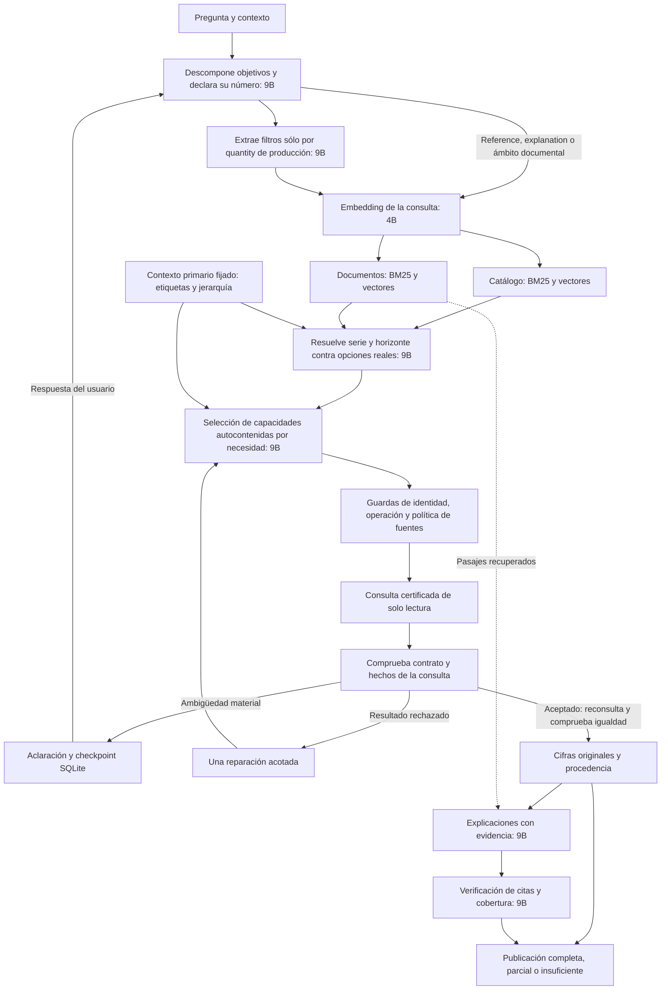

# Arquitectura LangGraph local

## Estado vigente: v8 experimental rechazado en consultas reales

El runtime actual es `langgraph-9b-v8`; su congelación final está en `evaluation/langgraph_rag_2026-11-01/user_prototype_queries_v2/code_freeze.json`. Los objetivos admiten descripciones interpretadas, su conteo se deriva del array y las ediciones se ofrecen desde metadatos de fuentes reales. Cada objetivo cuantitativo se vincula a capacidades certificadas; la consulta final vuelve a comprobar sus resultados. Alias y padres permanecen visibles sin filtros de palabras de la pregunta. El selector recibe el contexto USER para interpretar preferencias de edición con cobertura.

La revisión estática no equivale a exactitud semántica. En las tres preguntas reales, el 9B aún omite una unidad y selecciona una previsión antigua; además, su revisión acepta una explicación no respaldada por las citas. El candidato se rechaza para uso fiable y no sustituye la referencia aceptada. Detalles en `ESTADO.md` y `senior_audit/prototype_real_user_queries_v2_gate_review_v1.json`. Los bloques siguientes son históricos, no el estado vigente.

## Histórico: v7

El candidato vigente es `langgraph-9b-v7`, fijado en `evaluation/langgraph_rag_2026-11-01/preinference_freeze_v25.json`: 196 fuentes, SHA `54e041e717fd1880ead9c1e8363175ff0e5d67628866a205c2c966b240dc6573`. Pipeline final SHA `e06f7498cf0bdfc386a290ccc68b8b929ec6b6ab567f8f1bebeff4a79f1442c8`. DB original, assets, índices, baseline, golds y registro semántico v3 de 71 fichas permanecen intactos.

La descomposición sustituye COUNT en su misma llamada: declara el número de resultados y objetivos con fragmento literal, medida, tipo quantity/reference/explanation y edición. Sólo cada quantity de producción pasa por su extracción numérica; reference/explanation conservan petición y contexto sin recibir filtros numéricos inventados. En el ámbito de referencia todos los objetivos usan texto, con la misma capacidad documental declarada. RAW, mapa de identidades y conteos originales/retenidos quedan auditados. Se mantienen cuatro objetivos, diez chats, una reparación y 6400 bytes; la precisión semántica sigue dependiendo del 9B.

El incremento terminó con 52 pruebas dirigidas y revisión senior aprobada en `senior_audit/source_aware_goals_review_v2.json`. La raíz compactó después sólo el literal de REVIEW, de 869 a unos 749 bytes: instrucciones operativas en inglés, generación en español conservada. Mantiene todas las partes del objetivo, escenario/versión y testigos propios aprobados. La adenda `senior_audit/source_aware_goals_review_v3.json` aprobó exclusivamente ese delta y sus 15 pruebas posteriores. Cierre `design_audit/source_aware_goals_root_review_v1.json`: aprobación para prueba real, no adopción.

La residencia vigente es interpret `0s`, intent_audit `0s`, embedding `0s` y demás chats `5m`. Continúan Qwen3.5 9B y Qwen3-Embedding 4B, sin nuevos pesos ni inferencia de pago. GENERATE y REVIEW reciben el contexto original; las restricciones USER/clarificación no se convierten en evidencia factual ni dan autoridad a mensajes assistant.

Legacy11 real `live_legacy_v4` está en curso (sesión `14106`, `tmp/graph_live_legacy_v4.log`). Faltan su resultado y gate, suite unitaria completa nueva sin anticipar el conteo, desarrollo32 nuevo `live_dev_v9` y QA. La reserva8 permanece **sin abrir** hasta cerrar todos los gates. No hay adopción; apagado cancelado y ordenador encendido.

## Antecedente: freeze24

En freeze24 el candidato era `langgraph-9b-v6`, fijado en `evaluation/langgraph_rag_2026-11-01/preinference_freeze_v24.json`: 195 archivos, SHA `f5076caca0e50ae93c1ef5f6f3e95d330f678726ad58831f14a012bda93b2a30`. Cambian cuatro archivos de runtime y seis de pruebas/fixture. Fuentes, datos, índices, modelos y baseline permanecen intactos; se conserva el registro semántico v3 de 71 fichas. La política de residencia sigue siendo COUNT `5m`, EXTRACT (`intent_audit`) `0s`, embedding `0s` y demás chats `5m`.

Todos los chats usan Qwen3.5 9B. Qwen3-Embedding 4B genera vectores de 2.560 dimensiones. No hay fallback al 27B ni servicios de inferencia de pago.

La política de residencia está vinculada al manifest, al protocolo y a las peticiones reales: COUNT mantiene el 9B durante cinco minutos; EXTRACT (`intent_audit`) solicita descargarlo al terminar (`keep_alive=0s`); el embedding solicita descargar el 4B al terminar (`0s`); GROUND, selección y demás chats conservan el 9B (`5m`). Las llamadas siguen siendo secuenciales. Esto no demuestra por sí solo que no pueda haber solapamientos transitorios de memoria.

El incremento textual y sus 39 pruebas dirigidas están aprobados por revisión senior independiente en `senior_audit/text_contract_v7_review_v3.json`, con cierre de raíz `design_audit/text_contract_v7_root_review.json`. Sólo solicitudes RAW enteramente idénticas se agrupan, conservando extracción, mapa de identidades y conteos originales/retenidos. La alineación conservadora de blancos junto a puntuación restaura el span original sin alterar palabras, negaciones o números. REVIEW exige resultado y ámbito solicitados con testigos propios aprobados; el codec reconstruye íntegro el contexto protegido y conserva el esquema completo en `format`, sin duplicarlo en el sistema de REVIEW. El recorte P1 de la primera auditoría se corrigió en v2; la revisión v3 confirmó la búsqueda de una coincidencia válida después de rechazar `4%` dentro de `14%`.

Los payloads completos medidos ocupan 6382 y 6327 bytes, incluidos los campos nuevos y las notas del codec: margen de 18/73 bytes, sin reserva adicional de 300 ni garantía universal para cuatro necesidades. La aprobación del código no es adopción del sistema.

Legacy11 real `live_legacy_v3` terminó rechazado: siete respuestas completas de once, once seguras y cero errores técnicos. Se conserva `design_audit/live_legacy_v3_gate_rejected.json`; no acredita el código posterior. Los diagnósticos anteriores son evidencia histórica, no validación de freeze25.

Antecedentes de freeze23: los runs anteriores permanecen rechazados y no validan el incremento textual posterior.

Desarrollo32 `live_dev_v8` terminó con 23 aprobaciones automáticas y siete equivalencias aprobadas por QA: 30/32, dos errores técnicos en GROUND (`d22` y `d26`) y ningún otro fallo. Sigue rechazado en `design_audit/live_dev_v8_gate_rejected.json`; `live_dev_v8_primary_adjudications_v1.json` no constituye un replay con otro código. El esquema de freeze22 exige `type: null` si se pidió horizonte sin años ofrecidos; con años conserva array/null con mínimo uno y sin horizonte mínimo cero. No infiere años ni modifica unidades o fuentes. Pasan 15 pruebas en 0,016 s; revisión de raíz en `senior_audit/unavailable_horizon_root_review_v1.json`.

El piloto5 `live_unavailable_horizon_pilot_v1` terminó con EXIT0: tres aprobaciones automáticas y dos primarias, cinco controles correctos; QA y cierre en `design_audit/unavailable_horizon_pilot_primary_qa_v1.json` y `design_audit/unavailable_horizon_pilot_root_closure_v1.json`. Legacy v1 falló antes de inferir por scope incorrecto y no produjo resultados. El corpus legacy separado contiene los 13 fragmentos aceptados de 2025 con sus vectores 4B reales, autenticados offline sin reembedding; producción queda intacta. Manifest `legacy_assets_v1/manifest.json`, revisión `senior_audit/legacy_asset_preparation_root_review_v1.json`. Legacy11 `live_legacy_v2` terminó rechazado y sus resultados se conservan; la validación vigente se indica al principio de este archivo.

Antecedente de freeze21: `live_dev_v7` quedó en 31/32 tras QA y siguió rechazado por `d06`; el piloto4 `live_empty_horizon_pilot_v1` obtuvo cuatro controles correctos tras QA. La suite v3 pasó 211/211 en 657,694 s y su revisión verificó 187 huellas sin deriva. Ese resultado unitario corresponde a freeze21, no a freeze22.

Antecedente de freeze20: `live_grounding_budget_pilot_v2` obtuvo 11 aprobaciones automáticas y dos revisiones primarias aprobadas, sin fallos reales ni técnicos; `fullunit_v2` pasó 210/210 pruebas en 676,378 s. Las muestras de ese piloto registraron como máximo un modelo residente, mínimo de commit disponible de 6,673 GiB y máximo de memoria privada de Python de 1,314 GiB; no garantizan los picos entre muestras.

## Flujo actual

La descomposición identifica objetivos y edición; sólo la extracción cuantitativa asigna población, periodo y unidad. Los objetivos textuales conservan sus condiciones en el fragmento y contexto originales. Edición, unidad y fuente acotan el descubrimiento; los años tentativos no excluyen tablas antes de resolver el horizonte. La búsqueda léxica se centra en cada magnitud y los calificadores interpretados. La recuperación combina BM25 y similitud de vectores con fusión de rankings. El planificador selecciona capacidades reales con los metadatos y argumentos de cada fuente en una misma opción. No se deduce la intención mediante las reglas del buscador histórico ni se permite SQL libre generado por el modelo.

El candidato v7 conserva el registro autenticado v3 de contexto primario para 71 fichas: significado de etiquetas, total/subtotal/componente, función de la serie y relaciones entre fuentes. Cubre las 36 fichas de niveles y variaciones de los cuadros de gasto C9/C12 y añade roles verificados de previsiones de pensiones. Conserva todos los nombres y datos literales del catálogo y los registros v1/v2. La vista del modelo presenta la medida definida; muestra su etiqueta publicada cuando aparece literalmente en la pregunta o historia del usuario, y conserva siempre su procedencia original. El título pertenece al contenedor. La preferencia por `report_base` sólo actúa con edición expresa, sin serie u objeto pedidos, dentro de una familia compatible que cubra el horizonte solicitado; las versiones explícitas prevalecen. Las relaciones no acreditan igualdad numérica. Los subtotales requieren un selector de parte expresado por el usuario, y se vuelve a comprobar esa condición antes de consultar. La presencia de un selector por sí sola no garantiza una selección semántica correcta. Consultar el estado de validación en `ESTADO.md` y la revisión primaria en `evaluation/langgraph_rag_2026-11-01/design_audit/profiled_pilot_v2_primary_qa.json`.

Después de recuperar candidatos, una llamada conjunta del9B vincula las referencias naturales de serie y horizonte con etiquetas y años realmente ofrecidos. Conserva las opciones, la interpretación anterior y el resultado. Los años deben existir en los metadatos y aparecer en la pregunta o su contexto. La política de fuentes vuelve a aplicarse después de esa resolución. Esta etapa mantiene fijas edición, magnitud, unidad y población: un error inicial en esos campos sigue siendo una limitación que debe detectar la validación.

La extracción separa el nombre de la medida de sus años, unidad y publicación. Una etiqueta de escenario inventada que no se apoya en un fragmento literal de la pregunta o historia del usuario se descarta como filtro y deja una nota auditable; la extracción cruda se conserva. El contexto primario de las series distingue previsión, autor, componente y selector de agregado. El descubrimiento filtra operaciones imposibles sin convertir una interpretación temporal incompleta en una autorización de cálculo; después de resolver los años, la compilación y ejecución exigen los periodos y operandos exactos.

La revisión distingue una selección respaldada, una aclaración material y la ausencia de capacidad en el conjunto consultado; una aclaración no necesita publicar cifras para ser válida. Un cambio entre dos extremos requiere un intervalo publicado completo o dos niveles compatibles con permiso de cálculo. Dos sensibilidades anuales independientes no sustituyen ese cambio.

La resolución temporal depura los años iniciales; no añade otros años de publicación o contexto. Un año solicitado no disponible, distinto de la edición del informe, conserva su restricción y bloquea una sustitución. Las guardas comprueban la capacidad ofrecida, publicación, serie, unidad, periodo, ámbito, operación y política de fuentes. La ejecución final vuelve a consultar y exige igualdad exacta con los hechos comprobados. Una alteración es un error técnico. Las aclaraciones se limitan a ejes materiales ofrecidos y la falta de capacidad se refiere al conjunto evaluado. El candidato v4 retira el segundo veto general del mismo LLM, que producía rechazos falsos y no constituye una auditoría independiente. La selección semántica sigue dependiendo del planificador y de su evaluación externa.

La revisión narrativa sólo admite los identificadores de afirmaciones y necesidades existentes. En respuestas mixtas, las expresiones de cifras con unidad financiera quedan fuera del texto generado y se conservan los datos estructurados; las citas y los años siguen permitidos. Este detector está acotado a formas numéricas con unidad, no constituye un análisis universal del lenguaje. Una comparación de niveles no acredita por sí sola una explicación causal.

El usuario decidió priorizar el cuadro resumen y citar la discrepancia cuando dos fuentes relacionadas publican valores diferentes. Su primera relación contrastada es C9/G45 de 2025, para los cinco años realmente compartidos. La política se incorpora en un registro separado y autenticado, con evidencia PDF y celdas originales; no cambia la base ni declara que cifras distintas sean idénticas. Un objeto pedido expresamente prevalece sobre esta prioridad. Si falta un año en el cuadro, no se interpola. Los valores usados como contraste se distinguen del dato principal y conservan sus citas. Esta relación inicial no certifica automáticamente la equivalencia de todas las tablas y gráficos.

El catálogo agrupa 42.880 observaciones admitidas en 1.314 fichas. El corpus documental parte de los PDF certificados de AIReF de 2025 y 2026: 281 páginas y 440 fragmentos. Los datos conservan las celdas Excel o el localizador de su fuente oficial. Los 16 registros discrepantes autorizados conservan su aviso y prioridad de origen; no se corrigen sus sumas. Los cálculos derivados requieren compatibilidad y permiso de cálculo acreditados.

Los modelos comparten un semáforo: las búsquedas de catálogo y documentos pueden ejecutarse en paralelo, pero las llamadas a Ollama se serializan. Un embedding sirve para ambas búsquedas. El candidato v5 usa el mismo 9B sin razonamiento ampliado, con 1.024 tokens de salida y contexto 8.192 por etapa; los límites reales se comprueban. Cada informe conserva solicitudes, respuestas, opciones, hashes de modelos y fuentes, además del método de validación del contrato. El tracing externo está desactivado.

`answer_graph` acepta pregunta, contexto y un identificador de consulta. SQLite conserva las aclaraciones pendientes; al reanudar se autentican fuentes y estado. Un identificador completado no se reutiliza para otra pregunta: usar uno nuevo y pasar el contexto. Las cifras de la conversación anterior no se aceptan como evidencia.

Módulos: `graph_catalog` y `graph_documents` construyen y buscan los índices; `graph_models` restringe el transporte local; `graph_validation` comprueba planes, datos y procedencia; `graph_pipeline` implementa el grafo. `experiments.query_graph` y la entrada habitual `experiments.query_preserved` invocan este flujo. `experiments.graph_quality`, accesible también mediante `experiments.continuous_quality`, prepara protocolos y reproduce las trazas para evaluar el nuevo perfil.

La evaluación principal utiliza 32 preguntas naturales de desarrollo y ocho reservadas con el corpus completo. La comparación de once controles históricos tiene un alcance textual explícito: los 13 fragmentos de referencia de 2025 sin fichas numéricas expuestas. Ambos resultados se presentan por separado. Las referencias, el baseline y los datos originales permanecen intactos.

Esta arquitectura no acredita que cualquier pregunta sobre las 42.880 observaciones vaya a resolverse: hace falta medir recuperación, elección de serie, cifras, cobertura y ambigüedad. El banco reservado se utiliza después de congelar código, modelos e índices; si se modifica el sistema a partir de sus preguntas, deja de ser una reserva independiente.
