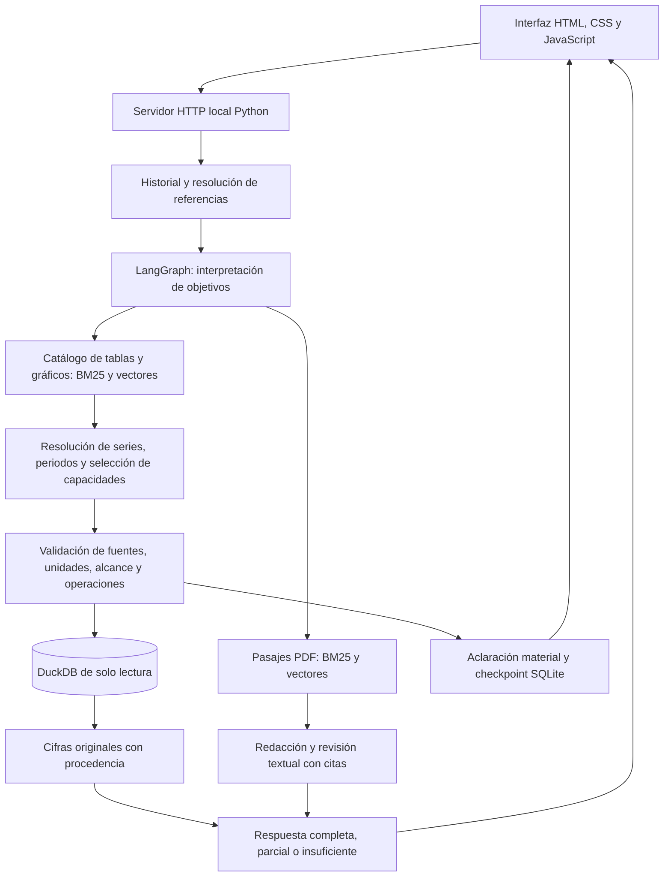

# RAG sobre pensiones y sostenibilidad fiscal — AIReF

Prototipo local con interfaz de chat para consultar documentos, tablas y gráficos de AIReF. Combina recuperación documental y datos estructurados para responder con citas y cifras que conservan publicación, periodo, unidad y procedencia. Proyecto en desarrollo: la configuración actual no tiene una validación completa de calidad y puede cometer errores de interpretación o selección.

## Instalación y ejecución

Requiere Python 3.11 y Ollama instalado y en ejecución en `http://127.0.0.1:11434`. Los modelos se descargan aparte; no se necesitan claves de API. Requiere memoria suficiente para un modelo 9B Q8 y embeddings 4B; el consumo y la latencia dependen del equipo y no se ha certificado un mínimo de hardware.

Descargar el ZIP del repositorio y extraerlo, o clonarlo con Git:

```powershell
git clone https://github.com/MartinHerreraRoncero/Portfolio-data-science.git
cd Portfolio-data-science/RAG
```

Comprobar que `python --version` muestra Python 3.11. Desde esta carpeta `RAG`, en PowerShell:

```powershell
python -m venv .venv
.\.venv\Scripts\python.exe -m pip install -r requirements-langgraph.lock.txt
.\.venv\Scripts\python.exe prepare_runtime.py
ollama pull qwen3.5:9b-q8_0
ollama pull qwen3-embedding:4b
.\.venv\Scripts\python.exe -m experiments.prototype_server
```

Abrir [la interfaz local](http://127.0.0.1:8765). Escribir una pregunta y enviarla; la interfaz muestra el progreso, la respuesta, sus fuentes y la traza de consulta. Permite continuar conversaciones y responder aclaraciones. El arranque del servidor no ejecuta inferencias. Detenerlo con `Ctrl+C`.

Ejemplo: «Según el informe de 2026, ¿qué gasto en pensiones se prevé para 2050?».

La interfaz escucha exclusivamente en el equipo local. No está preparada para exponerla a Internet. Los informes y checkpoints se escriben en `outputs/`; el historial del chat se mantiene en memoria del servidor. `prototipo_contexto.json` fija la preferencia por la publicación más reciente que cubra lo solicitado y distingue año del dato y año de publicación.

También se puede consultar sin interfaz:

```powershell
.\.venv\Scripts\python.exe -m experiments.query_graph --query "Según el informe de 2026, ¿qué gasto en pensiones se prevé para 2050?" --context prototipo_contexto.json --output outputs/consulta.json
```

Usar una ruta de salida nueva para cada consulta. El CLI admite `--json`, `--thread-id` y `--resume` para inspeccionar trazas y continuar aclaraciones. Las etiquetas de Ollama deben coincidir con los digests declarados en `rag_pensiones/graph_types.py`; cambiar de pesos requiere revisar esa compatibilidad.

## Arquitectura actual



- **Interfaz:** `experiments/prototype_server.py` sirve el chat y lanza el CLI con el mismo intérprete Python. Los módulos de presentación adjuntan citas y procedencia; la interfaz consulta eventos de progreso y conserva la conversación.
- **Orquestación:** `rag_pensiones/graph_pipeline.py` construye el grafo de LangGraph. Interpreta necesidades, recupera fuentes, selecciona capacidades permitidas, comprueba resultados y admite una reparación acotada o aclaraciones persistidas en SQLite.
- **Recuperación:** combina BM25 y similitud semántica con fusión de rankings sobre el catálogo y los pasajes. La diversificación por objeto de origen está activada. El reranker opcional está desactivado por defecto; sus pesos y dependencias no se incluyen en esta entrega.
- **Modelos locales:** Qwen3.5 **9B Q8** interpreta, selecciona y revisa texto; Qwen3-Embedding **4B**, con 2.560 dimensiones, genera embeddings. La configuración actual usa `think=False` y contexto de chat de 32.768 tokens. Los embeddings se ejecutan en CPU y las llamadas a Ollama se serializan para controlar la concurrencia.
- **Datos y guardas:** DuckDB conserva datos certificados y localizadores de origen. El modelo elige operaciones de un contrato; no ejecuta SQL libre. Las cifras se publican desde los registros consultados. Los contextos semánticos y las políticas curadas distinguen series, componentes y publicaciones.

El historial ayuda a resolver referencias, pero las respuestas anteriores del modelo no constituyen evidencia. Las citas se seleccionan mediante identificadores y se adjuntan desde el texto original. La revisión del mismo modelo y las guardas estructurales no garantizan corrección semántica.

## Recorrido técnico de una consulta

El estado compartido del grafo (`GraphState`) transporta pregunta, contexto efectivo, interpretación, candidatos, plan, hechos numéricos, afirmaciones textuales, llamadas al modelo y errores. `answer_graph(query, *, context=None, thread_id=None, resume=None, services=None, checkpoint_path=None)` es la entrada de Python. Los servicios agrupan catálogo, corpus, cliente de modelos, base de datos y políticas autenticadas.

| Nodo | Responsabilidad |
| --- | --- |
| `interpret` | Resuelve referencias conversacionales y descompone la petición en resultados solicitados. Una referencia ambigua puede producir una aclaración antes de recuperar fuentes. |
| `intent_audit` | Extrae las necesidades y sus atributos; distingue resultados cuantitativos de referencias o explicaciones. |
| `embed` | Calcula un vector de la consulta resuelta, compartido por las dos búsquedas. Exige que ambos índices semánticos estén presentes. |
| `catalog` / `documents` | Recupera fichas cuantitativas y pasajes documentales en ramas paralelas. |
| `ground` | Vincula las referencias de serie y horizonte con las etiquetas y periodos realmente disponibles. |
| `plan` / `validate` | Selecciona capacidades y verifica que el plan conserve las necesidades y respete los contratos de las fuentes. |
| `clarify` | Interrumpe el grafo ante una ambigüedad material y conserva el estado para reanudarlo. |
| `execute` | Consulta datos certificados mediante operaciones permitidas y comprueba los hechos obtenidos. |
| `generate` / `review` | Construye afirmaciones textuales con evidencia y revisa su apoyo y cobertura. |
| `prepare_repair` / `publish` | Prepara una reparación textual cuando procede y publica las partes respaldadas con sus carencias. |

Las transiciones son condicionales: un error puede desviar directamente a publicación; un plan inválido puede volver a planificación mientras el contador compartido de reparaciones sea menor que dos. Una omisión textual puede activar `prepare_repair` si ese contador es menor que uno. Estos límites evitan ciclos indefinidos; no garantizan que una reparación tenga éxito.

### Recuperación híbrida y diversidad

El catálogo representa series y capacidades de tablas y gráficos; las observaciones conservan los valores y localizadores de origen. El corpus documental representa fragmentos PDF con metadatos y procedencia. Ambos índices se distribuyen precalculados en la instantánea.

La búsqueda combina dos rankings: **BM25**, que mide correspondencia léxica, y similitud de vectores normalizados mediante producto escalar. Se fusionan con **Reciprocal Rank Fusion (RRF)**: cada ranking aporta `1 / (60 + posición)`. Se suman las aportaciones de cada candidato; así se combinan posiciones sin tener que equiparar las escalas de BM25 y similitud. Los empates se resuelven de forma determinista por identificador.

Para el catálogo se recupera un conjunto de hasta 50 candidatos por necesidad antes de diversificar y seleccionar, con un objetivo inicial de diez fichas por necesidad. La diversidad prioriza objetos de origen distintos y después rellena por puntuación. Las políticas de fuentes, las relaciones semánticas y la expansión de filas hermanas pueden ampliar el conjunto posterior: diez no es un límite absoluto del contexto final. La búsqueda documental devuelve hasta seis pasajes. La edición solicitada y la elegibilidad de capacidades restringen el descubrimiento; `ground` resuelve después series y horizontes contra opciones reales.

El reranker es una extensión opcional, no una etapa activa del paquete. La diversidad funciona sin cargar un segundo modelo de ranking. La recuperación de una fuente relevante tampoco acredita que el planificador vaya a escogerla correctamente.

### Contratos, datos y procedencia

Las respuestas del LLM se solicitan como objetos JSON con un esquema estructural y se validan en Python. Los esquemas restringen tipos, campos e identificadores ofrecidos. El plan debe conservar una selección por cada necesidad interpretada; no puede introducir una ficha ajena al conjunto candidato, otra publicación explícitamente excluida ni periodos ausentes en la fuente. Las necesidades textuales no pueden inventar una fuente numérica.

La capa de ejecución separa lectura de valores, variaciones publicadas y diferencias calculadas cuando la capacidad y la compatibilidad lo permiten. Las comprobaciones consideran unidad, periodo, serie, ámbito y política de origen. Una variación publicada y una diferencia calculada no se tratan como operaciones intercambiables sin condiciones. Los resultados se vuelven a contrastar antes de publicarse y conservan los identificadores y localizadores de las observaciones originales.

`CertifiedStructuredRetriever` abre DuckDB en modo de solo lectura. El sistema comprueba hashes de la base, certificados y archivos fuente; `graph_source_policy` y `graph_context` autentican las políticas y el contexto semántico. El manifiesto de ejecución registra huellas de código y recursos, identidad de modelos, parámetros y configuración de recuperación. Esto permite detectar cambios del entorno y reconstruir qué configuración produjo un informe; no demuestra por sí solo exactitud de la respuesta.

La publicación distingue `answered`, `partial` e `insufficient_evidence`; el flujo también puede terminar en aclaración o error técnico. Las afirmaciones respaldadas y las partes pendientes se conservan por separado. La evidencia textual se selecciona por identificadores y las citas se adjuntan desde los pasajes originales, evitando que el modelo tenga que reconstruirlas de memoria.

### Transporte de modelos y presupuestos

`GraphStageClient` utiliza la API HTTP local de Ollama: `/api/tags` para verificar identidades, `/api/chat` para texto y `/api/embed` para embeddings. Comprueba el digest del modelo antes y después de cada inferencia y registra solicitud, respuesta, duración y errores por etapa. El tracing externo de LangSmith está desactivado.

| Parámetro | Configuración del paquete |
| --- | --- |
| Modelo de texto | `qwen3.5:9b-q8_0` |
| Modelo de embeddings | `qwen3-embedding:4b`, 2.560 dimensiones |
| Contexto de chat | 32.768 tokens |
| Salida de chat | Presupuesto base de 8.192 tokens, adaptado al espacio disponible hasta 24.576 |
| Razonamiento ampliado | `think=False` |
| Muestreo | Temperatura 0,7; `top_p=0.8`; `top_k=20`; `min_p=0`; semilla 42 |
| Embeddings | CPU (`num_gpu=0`), contexto 8.192, `truncate=False` |
| Solicitud de chat | Máximo 16 KiB del JSON completo |
| Entrada de embeddings | Máximo 6.400 bytes por texto y 32 textos por llamada |
| Respuesta HTTP del modelo | Máximo 16 MiB |

Los límites de bytes y tokens son controles distintos. Antes de inferir se aplica una cota conservadora del contexto; después se comprueban los contadores reales de Ollama. Una respuesta incompleta, truncada o que supere los presupuestos se rechaza. La salida estructurada se vuelve a analizar como JSON. El semáforo de inferencia serializa llamadas al backend aunque las búsquedas del grafo se organicen en paralelo.

### Interfaz, proceso y persistencia

La interfaz usa HTML, CSS y JavaScript sin un servidor Node ni un paso de compilación. El backend se implementa con `ThreadingHTTPServer` de Python y lanza cada consulta mediante `sys.executable -m experiments.query_graph`, con argumentos separados y `shell=False`. Un bloqueo admite una consulta a la vez; una segunda petición concurrente recibe HTTP 409.

| Ruta HTTP | Función |
| --- | --- |
| `GET /` | Página del chat |
| `GET /assets/chat.css`, `GET /assets/chat.js` | Estilos y lógica de la interfaz |
| `GET /health` | Estado del servidor y señal de consulta en curso |
| `POST /query` | Pregunta nueva o continuación de una aclaración |
| `GET /progress/<request_id>?after=<cursor>` | Eventos de progreso mediante consultas periódicas |
| `GET /report/<report_id>` | Informe JSON de la consulta |
| `POST /new-conversation`, `POST /end-session` | Gestión de la conversación y cierre de sesión |

Una petición de consulta contiene `query` y puede incluir `conversation_id` y `request_id`; una aclaración incorpora `resume` y su `thread_id`. Los identificadores se validan como UUID. El servidor comprueba que la aclaración pertenece a la conversación y pregunta pendientes. Los eventos de progreso se separan de la salida del modelo; no se transmite una respuesta token a token al navegador.

`ConversationStore` conserva el historial en RAM y el contexto general procede de `prototipo_contexto.json`. Las aclaraciones usan checkpoints SQLite y archivos de sesión. En `outputs/prototipo/` se guardan entrada, informe, salida del proceso y presentación; contienen información de la consulta y deben tratarse como archivos locales del usuario. Reiniciar el servidor pierde el historial en memoria aunque existan informes y checkpoints. Estos archivos generados están excluidos de Git.


## Contenido del paquete

| Ruta | Función |
| --- | --- |
| `rag_pensiones/` | Grafo, recuperación, modelos, contratos y validación |
| `experiments/` | Entradas CLI, servidor, interfaz y módulos importados por el runtime |
| `runtime/` | Recursos de consulta comprimidos y manifiesto SHA-256 |
| `prepare_runtime.py` | Restaura y comprueba los recursos sin descargar ni ejecutar modelos |
| `prototipo_contexto.json` | Preferencias generales de consulta |
| `requirements*.txt` | Dependencias y versiones del entorno |

La instantánea contiene 1.314 fichas, 42.880 observaciones y 440 fragmentos documentales. No es necesario recalcular embeddings. Los recursos comprimidos se restauran en sus rutas originales; algunas están bajo `evaluation/` por compatibilidad del código, pero contienen la base y certificados imprescindibles, no una batería de pruebas. Algunos módulos de curación permanecen en `experiments/` porque el runtime importa sus definiciones: no son versiones alternativas del sistema.

Se excluyen tests, resultados de experimentos, vídeos, versiones anteriores, entornos virtuales, pesos de modelos y conversaciones guardadas. Esta distribución permite consultar la instantánea incluida; no reproduce todo el proceso histórico de construcción del corpus.

## Reproducibilidad y seguridad local

Se comprobó la instalación en una copia nueva descargada de GitHub, con un entorno virtual independiente de Python 3.11 en Windows: descarga pública de las dependencias, `pip check`, restauración de los doce recursos, carga de la interfaz y una consulta real a través del backend HTTP. Los modelos ya instalados se contrastaron con los manifiestos públicos de Ollama y sus digests coinciden con los exigidos. No se necesita ningún archivo privado del equipo del autor; Python, Ollama y la descarga separada de los modelos son prerrequisitos. Esta comprobación no certifica otros sistemas operativos ni equipos con memoria insuficiente, ni evalúa la calidad general de las respuestas.

El servidor sólo escucha en `127.0.0.1:8765`; las lecturas exigen un `Host` local permitido y las escrituras comprueban además `Origin`. No ofrece autenticación entre usuarios del mismo equipo: los informes y conversaciones deben permanecer en un entorno local de confianza. Los textos del modelo se insertan en la interfaz mediante `textContent`, los identificadores de informes se validan como UUID y los procesos se lanzan sin shell. El cliente de Ollama rechaza endpoints externos, proxies y redirecciones.

El paquete no necesita tokens ni credenciales. No publicar `outputs/`, archivos `.env`, checkpoints ni conversaciones: pueden contener preguntas e información del usuario. La revisión estática y la comprobación de dependencias reducen riesgos, pero no constituyen una garantía absoluta de seguridad. La auditoría de dependencias del 4 de noviembre de 2026 detectó 26 avisos conocidos en `pypdf==6.16.1`. Se probó la versión corregida 6.21.4, pero cambia la extracción textual y la autenticación rechaza el corpus existente; se conserva la versión compatible, sin desactivar las guardas. Actualizarla requiere reconstruir y validar los recursos afectados. El riesgo de documentos manipulados está acotado porque los PDF de la instantánea se autentican mediante hashes antes de leerse y la interfaz no permite subir documentos arbitrarios, pero los avisos siguen pendientes.

## Alcance y límites

El perfil actual se identifica como `langgraph-9b-v8`. No se trasladan métricas de versiones anteriores a esta configuración. Persisten riesgos de omitir necesidades, elegir una serie o publicación equivocada y aceptar explicaciones no respaldadas. Una cita literal no demuestra por sí sola que la respuesta responda correctamente a la pregunta. Revisar siempre el periodo, la unidad, la fuente y el significado de los datos.

El alcance principal son las fuentes incluidas de 2025 y 2026. No calcula pensiones individuales ni constituye un sistema de producción. Las discrepancias entre fuentes conservan avisos y políticas explícitas; no se corrigen inventando cifras.

## Fuentes

Documentos y libros de datos de AIReF: Opinión sobre sostenibilidad a largo plazo de 2025 y Estudio de evaluación de la regla de gasto en pensiones de 2026. Se incluye una fuente puntual de contraste del Tesoro Público, su estrategia de financiación de 2022. Los recursos conservan sus hashes y localizadores. Los datos derivados y anotaciones del proyecto no son publicaciones oficiales y este proyecto no implica respaldo institucional. Los derechos de los materiales de terceros pertenecen a sus titulares; no se concede aquí una licencia adicional sobre ellos.
