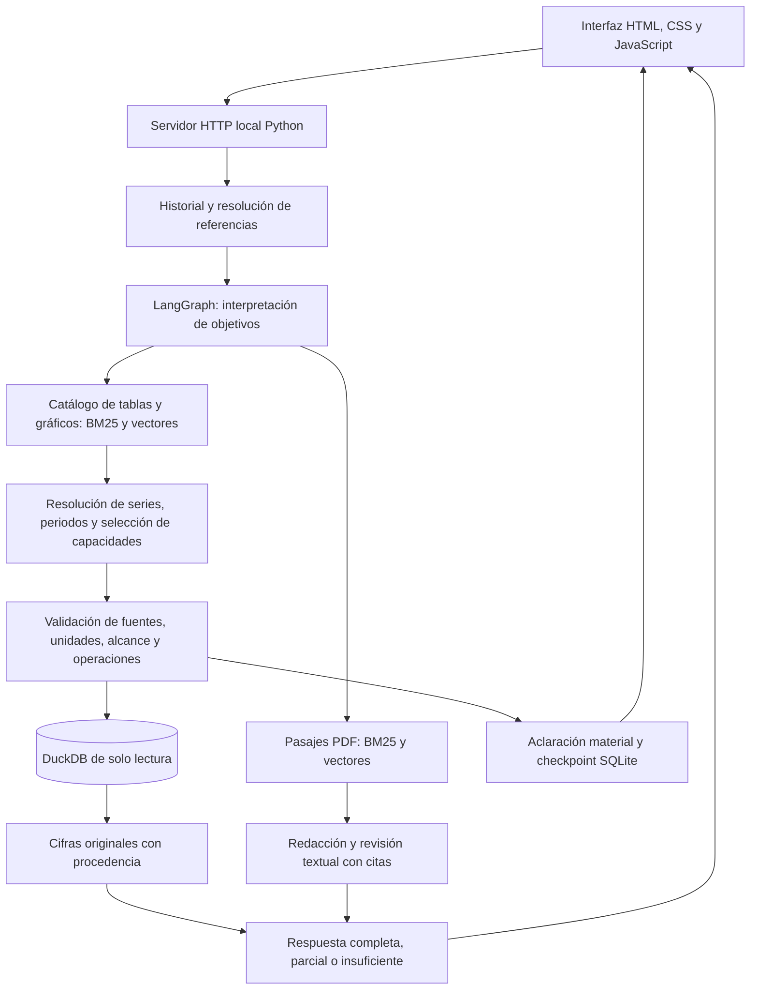

# RAG sobre pensiones y sostenibilidad fiscal — AIReF

Prototipo local con interfaz de chat para consultar documentos, tablas y gráficos de AIReF. Combina recuperación documental y datos estructurados para responder con citas y cifras que conservan publicación, periodo, unidad y procedencia. Proyecto en desarrollo: la configuración actual no tiene una validación completa de calidad y puede cometer errores de interpretación o selección.

## Instalación y ejecución

Requiere Python 3.11 y Ollama instalado y en ejecución en `http://127.0.0.1:11434`. Los modelos se descargan aparte; no se necesitan claves de API. Requiere memoria suficiente para un modelo 9B Q8 y embeddings 4B; el consumo y la latencia dependen del equipo y no se ha certificado un mínimo de hardware.

Desde la carpeta `RAG` del repositorio, en PowerShell:

```powershell
python -m venv .venv
.\.venv\Scripts\python.exe -m pip install -r requirements-langgraph.lock.txt
.\.venv\Scripts\python.exe prepare_runtime.py
ollama pull qwen3.5:9b-q8_0
ollama pull qwen3-embedding:4b
.\.venv\Scripts\python.exe -m experiments.prototype_server
```

Abrir [la interfaz local](http://127.0.0.1:8765). Escribir una pregunta y enviarla; la interfaz muestra el progreso, la respuesta, sus fuentes y la traza de consulta. Permite continuar conversaciones y responder aclaraciones. El arranque del servidor no ejecuta inferencias. Detenerlo con `Ctrl+C`.

Ejemplo: «Según el informe de 2026, ¿qué gasto en pensiones se prevé para 2050?».

La interfaz escucha exclusivamente en el equipo local. No está preparada para exponerla a Internet. Los informes y checkpoints se escriben en `outputs/`; el historial del chat se mantiene en memoria del servidor. `prototipo_contexto.json` fija la preferencia por la publicación más reciente que cubra lo solicitado y distingue año del dato y año de publicación.

También se puede consultar sin interfaz:

```powershell
.\.venv\Scripts\python.exe -m experiments.query_graph --query "Según el informe de 2026, ¿qué gasto en pensiones se prevé para 2050?" --context prototipo_contexto.json --output outputs/consulta.json
```

Usar una ruta de salida nueva para cada consulta. El CLI admite `--json`, `--thread-id` y `--resume` para inspeccionar trazas y continuar aclaraciones. Las etiquetas de Ollama deben coincidir con los digests declarados en `rag_pensiones/graph_types.py`; cambiar de pesos requiere revisar esa compatibilidad.

## Arquitectura actual



- **Interfaz:** `experiments/prototype_server.py` sirve el chat y lanza el CLI con el mismo intérprete Python. Los módulos de presentación adjuntan citas y procedencia; la interfaz consulta eventos de progreso y conserva la conversación.
- **Orquestación:** `rag_pensiones/graph_pipeline.py` construye el grafo de LangGraph. Interpreta necesidades, recupera fuentes, selecciona capacidades permitidas, comprueba resultados y admite una reparación acotada o aclaraciones persistidas en SQLite.
- **Recuperación:** combina BM25 y similitud semántica con fusión de rankings sobre el catálogo y los pasajes. La diversificación por objeto de origen está activada. El reranker opcional está desactivado por defecto; sus pesos y dependencias no se incluyen en esta entrega.
- **Modelos locales:** Qwen3.5 **9B Q8** interpreta, selecciona y revisa texto; Qwen3-Embedding **4B**, con 2.560 dimensiones, genera embeddings. La configuración actual usa `think=False` y contexto de chat de 32.768 tokens. Los embeddings se ejecutan en CPU y las llamadas a Ollama se serializan para controlar la concurrencia.
- **Datos y guardas:** DuckDB conserva datos certificados y localizadores de origen. El modelo elige operaciones de un contrato; no ejecuta SQL libre. Las cifras se publican desde los registros consultados. Los contextos semánticos y las políticas curadas distinguen series, componentes y publicaciones.

El historial ayuda a resolver referencias, pero las respuestas anteriores del modelo no constituyen evidencia. Las citas se seleccionan mediante identificadores y se adjuntan desde el texto original. La revisión del mismo modelo y las guardas estructurales no garantizan corrección semántica.

## Contenido del paquete

| Ruta | Función |
| --- | --- |
| `rag_pensiones/` | Grafo, recuperación, modelos, contratos y validación |
| `experiments/` | Entradas CLI, servidor, interfaz y módulos importados por el runtime |
| `runtime/` | Recursos de consulta comprimidos y manifiesto SHA-256 |
| `prepare_runtime.py` | Restaura y comprueba los recursos sin descargar ni ejecutar modelos |
| `prototipo_contexto.json` | Preferencias generales de consulta |
| `requirements*.txt` | Dependencias y versiones del entorno |

La instantánea contiene 1.314 fichas, 42.880 observaciones y 440 fragmentos documentales. No es necesario recalcular embeddings. Los recursos comprimidos se restauran en sus rutas originales; algunas están bajo `evaluation/` por compatibilidad del código, pero contienen la base y certificados imprescindibles, no una batería de pruebas. Algunos módulos de curación permanecen en `experiments/` porque el runtime importa sus definiciones: no son versiones alternativas del sistema.

Se excluyen tests, resultados de experimentos, vídeos, versiones anteriores, entornos virtuales, pesos de modelos y conversaciones guardadas. Esta distribución permite consultar la instantánea incluida; no reproduce todo el proceso histórico de construcción del corpus.

## Alcance y límites

El perfil actual se identifica como `langgraph-9b-v8`. No se trasladan métricas de versiones anteriores a esta configuración. Persisten riesgos de omitir necesidades, elegir una serie o publicación equivocada y aceptar explicaciones no respaldadas. Una cita literal no demuestra por sí sola que la respuesta responda correctamente a la pregunta. Revisar siempre el periodo, la unidad, la fuente y el significado de los datos.

El alcance principal son las fuentes incluidas de 2025 y 2026. No calcula pensiones individuales ni constituye un sistema de producción. Las discrepancias entre fuentes conservan avisos y políticas explícitas; no se corrigen inventando cifras.

## Fuentes

Documentos y libros de datos de AIReF: Opinión sobre sostenibilidad a largo plazo de 2025 y Estudio de evaluación de la regla de gasto en pensiones de 2026. Se incluye una fuente puntual de contraste del Tesoro Público, su estrategia de financiación de 2022. Los recursos conservan sus hashes y localizadores. Los datos derivados y anotaciones del proyecto no son publicaciones oficiales y este proyecto no implica respaldo institucional. Los derechos de los materiales de terceros pertenecen a sus titulares; no se concede aquí una licencia adicional sobre ellos.
