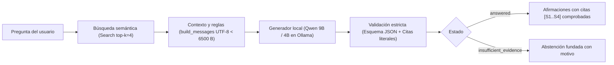

# RAG Pensiones AIReF — Planificación y recuperación local

## Nuevo flujo LangGraph: texto íntegramente con 9B

La entrada `experiments.query_preserved` utiliza ahora un grafo con Qwen3.5 9B para interpretar la pregunta, seleccionar datos y verificar el texto. Los embeddings mantienen Qwen3-Embedding 4B. El 27B queda fuera de esta entrada. La validación real del candidato está en curso: las cifras de calidad históricas que aparecen después no acreditan este nuevo perfil.

El catálogo contiene 1.314 fichas y 42.880 observaciones; la búsqueda documental nueva incluye los PDF certificados de 2025 y 2026. La pregunta se interpreta con el LLM, se buscan fichas y pasajes en paralelo, y un plan validado consulta datos de solo lectura. Las cifras se publican desde los registros originales, con serie, periodo, unidad y origen. Las ambigüedades materiales pueden detener el grafo para pedir aclaración.

```powershell
.\.venv-langgraph\Scripts\python.exe -m experiments.query_preserved --query "Según el informe de 2026, ¿qué gasto en pensiones se prevé para 2050?" --output outputs/mi_consulta.json
```

El comando necesita los índices nuevos de `data/processed/langgraph_9b_assets`. Antes de cargar Ollama, avisar al usuario y dejar margen de RAM y GPU. Entorno aislado: `requirements-langgraph.txt` y `requirements-langgraph.lock.txt`. Arquitectura y límites en [ARQUITECTURA.md](ARQUITECTURA.md).

## Referencias históricas: integración anterior

Las secciones siguientes conservan experimentos y resultados anteriores con sus modelos e índices originales. Sus descripciones del «flujo habitual» corresponden al momento de cada ensayo. Las funciones `legacy_main` conservan las entradas anteriores para reproducirlas; no son la nueva entrada por defecto.

La entrada `experiments.query_preserved` consulta la base certificada y los embeddings en paralelo. Las cifras conservan su serie, periodo, unidad y celda Excel; las explicaciones respaldadas conservan las citas PDF. Las peticiones ambiguas requieren aclaración. El CLI incluye una reparación acotada de omisiones de cobertura, verificada antes de publicarse; `--no-coverage-correction` permite desactivarla.

Validación local del 1 de noviembre: tres pilotos reales —Cuadro 9/2025, Cuadro 12/2026 y Gráfico 20/2026—, 42/42 comprobaciones independientes y evaluación nueva con 11/11 controles de calidad, sin errores técnicos, avisos ni regresiones. Pruebas, fuentes, incidencias conservadas y límites en [VALIDACION.md](evaluation/structured_rag_2026-11-01/VALIDACION.md).

```powershell
python -m experiments.query_preserved --query "Según el Cuadro 12 de 2026, ¿cuál es el gasto en pensiones en 2050?"
```

Las consultas cargan los LLM locales: avisar antes de ejecutarlos y evitar inferencias pesadas simultáneas con juegos. El índice textual sigue limitado al PDF de 2025; los datos numéricos de 2026 proceden de la base. Para reproducir el perfil validado mediante Python, usar `answer_covered(..., coverage_correction=True)`; las APIs conservan sus valores anteriores. Las variantes históricas y el planificador descritos más abajo mantienen sus recorridos propios.

## Extracción estructurada local (opcional)

Nuevo extractor con Docling, perfiles geométricos revisados y exportación a JSON/DuckDB con procedencia por celda. El piloto de las páginas 95–101 supera 15/15 referencias visuales y 814 tests; auditoría hostil y senior aprobadas. Los cuadros 9 y 10 requieren los perfiles manuales ligados al SHA del PDF. El índice habitual y el perfil mixto se mantienen; la vista nueva dispone de una herramienta independiente para preparar un índice candidato.

[Guía y comando de extracción](evaluation/document_layout_2026-10-27/README.md) · [Validación, artefactos y límites](evaluation/document_layout_2026-10-27/VALIDACION.md).

**Efecto medido sobre las respuestas:** 34 ejecuciones nuevas comparando la extracción anterior y el candidato estructurado, con los modelos mixtos conservados. Ambos obtienen 10/11 respuestas adecuadas en el control y 0/6 en preguntas de tablas; cero errores técnicos. El empaquetador descarta las filas de la tabla y el verificador acepta cifras de Clases Pasivas para otros conceptos. Se mantiene el índice habitual. La prioridad es conservar la estructura tabular en las citas y comprobar la correspondencia semántica. [Comparación, diagnóstico y límites](evaluation/layout_answer_effect_2026-10-27/COMPARACION_RESPUESTAS.md).

## Perfil anterior y ensayos de contexto

Configuración activa, por decisión del usuario: **Qwen3-Embedding 4B**, 2.560 dimensiones, con índice `data/processed/airef_2025_qwen3_4b_embeddings.json`. Búsqueda, respuestas, flujo semántico y evaluación seleccionan ese cliente por defecto. Gemma queda fuera del flujo activo; los índices anteriores se conservan para reproducir los ensayos históricos mediante `--index` explícito.

Selección y redacción: Qwen3.5 9B. Verificación y reverificación: Qwen 3.8 27B Q3_K_M. Con el embedding Qwen4B compartido, obtiene 11/16 y 10/16 respuestas con dato solicitado y citas suficientes; K2 Horizon 7B obtiene 8/16 en ambas pasadas. Se mantiene Qwen9B. Son veinte preguntas conocidas repetidas, bajo el presupuesto actual y sin evaluar el razonamiento alto recomendado para K2. [Comparación y límites](evaluation/QWEN_HORIZON_COMPARISON.md). El [ensayo previo de embeddings](evaluation/EMBEDDING_COMPARISON.md) se conserva; la activación actual responde a la elección expresa del usuario.

**Comparación de latencia (27/10/2026): se mantiene el sistema mixto.** En 22 ejecuciones nuevas de once preguntas conocidas, 9B Q4_K_M + 27B Q3_K_M obtiene 11/11 publicaciones satisfactorias contando citas (10/11 directas), frente a 9/11 con 27B en todo el texto. Medianas: 88,22 y 67,23 s; el 80,3 % de la diferencia acumulada se concentra en B08/n03, que el 27B deja incompletas. Embeddings 4B compartidos, 755 tests y cero errores técnicos. [Comparación, diagnóstico y límites](evaluation/mixed_single27_2026-10-27/COMPARACION_MIXTO_VS_27B.md).

**Base de trabajo elegida por el usuario: conservación de contexto anterior.** La entrada habitual para consultas directas usa Qwen4B/top4, Qwen9B en selección y redacción, Qwen27B Q3_K_M en verificación, selección de un paquete y publicación con sus antecedentes completos. Las variantes de notas/paquetes y el crítico experimental anterior siguen disponibles para comparación. El perfil habitual incorpora ahora la comprobación de alcance y la publicación parcial. Ejecutar desde la raíz del proyecto:

```powershell
python -m experiments.query_preserved --query "¿Desde qué año está cerrado a nuevos entrantes el régimen de Clases Pasivas?"
```

Muestra la respuesta y las citas con página. `--output evaluation/mi_consulta.json` guarda publicación, resultado canónico, recuperación y trazas en una ruta nueva; `--json` imprime el informe completo. No modifica los comandos existentes de planificación. La consulta real de comprobación responde2011 y conserva ambas citas de la página96; 477tests offline OK. [Perfil seleccionado y huellas](evaluation/restore_preserved_profile.json), [comprobación real](evaluation/restore_preserved_smoke.json).

**B07/B08 integrados (26 de octubre):** la entrada habitual añade auditoría de alcance con Q3 y conserva los hechos aprobados de consultas mixtas aunque otra afirmación resulte rechazada. B07 se abstiene sin sustituir mujeres en 2050 por totales de otros años; B08 y la variante de 2030 conservan 2015 con citas y explicitan el importe individual no respaldado. 725 tests y once consultas completas sin errores técnicos; 11/11 publicaciones correctas o seguras contando las citas, pero en n02 el año solo aparece en el contexto citado (10/11 respuestas directas). Mediana de los ocho controles comunes: 91,13 s; recargas pendientes de optimizar. `--factual-only` mantiene el flujo Q3 factual y `--legacy-verifier` el anterior con 9B. [Cambios, ensayos fallidos y límites](evaluation/scope_coverage_2026-10-26/RESULTADOS_B07_B08.md).

**Prueba de solo notas completada:** con un único paquete y los mismos modelos, las respuestas completas correctas se mantienen en 15/16 en el bloque inicial y pasan de 5/8 a 6/8 en el adicional. Recupera la ratio pensionistas/pensiones de 0,9; las otras 31 publicaciones son idénticas, sin regresiones nuevas observadas. Fuera de alcance se mantiene en 3/4 y 4/4 seguros. Son preguntas conocidas de las mismas cinco páginas, sin validación humana independiente. 481 pruebas offline, 195 llamadas locales y cero errores técnicos; el perfil habitual anterior sigue intacto. [Ensayo y límites](evaluation/NOTES_ONLY_TRIAL.md).

**Auditoría histórica de la base anterior (25 de octubre):** ocho preguntas nuevas, tres pasadas completas. Cuatro de cinco preguntas respondibles salen correctas3/3; Cataluña se rechaza3/3, pero una pregunta por mujeres recibe cifras generales3/3. La mixta devuelve el dato conocido y omite la petición individual, sin inventar un importe ni rechazarla explícitamente. Las ocho respuestas publicadas son idénticas entre repeticiones: los fallos observados son repetibles. En las15ejecuciones respondibles los pasajes necesarios ya estaban recuperados y seleccionados; b05falla porque el verificador confunde descenso a largo plazo con aumento inicial. No se ha mejorado ni cambiado el RAG en esta prueba. [Resultados por pregunta, etapas y límites](evaluation/BASELINE_STABILITY_AUDIT.md).

**Planificador conectado y comparado con notas:** reutiliza el planificador existente y valida los pasajes ampliados con identificadores globales, conservando la publicación contextual separada. En 14 preguntas conocidas obtiene 5/10 respuestas completas respondibles frente a 6/10 del control directo; ambos rechazan correctamente las tres preguntas fuera de alcance. La mixta rechaza el cálculo individual, pero ninguno publica la parte útil. Usa 100 llamadas al generador frente a 50, mediana 8,83 s frente a 4,64 s. Cero errores técnicos, 490 tests; no se activa por defecto. [Integración, resultados y límites](evaluation/PLANNED_PRESERVED_TRIAL.md).

Entrada experimental con planificador: `python -m experiments.query_planned_preserved --query "..."`. Añadir `--direct` ejecuta el control con notas sin planificar; `--json` o `--output evaluation/mi_prueba.json` muestra o guarda trazas y partes. Los comandos habituales anteriores conservan sus defaults.

**Retención de notas probada:** adelantar todas las notas recuperó la ratio, pero perdió la respuesta de pensiones no contributivas (5/10 frente a 5/10). La segunda variante coloca cada nota recuperada junto al párrafo que la cita, con enlaces verificados en el PDF: obtiene 5/10 frente a 4/10 del control fresco, sin perder sus aciertos. Se conserva el párrafo de no contributivas, pero otra subpregunta bloquea la respuesta final; no cumple todo el criterio de adopción. Los tres casos fuera de alcance siguen seguros. 502 pruebas offline y cero errores técnicos. Son planes reutilizados y preguntas conocidas; la variación del control impide atribuir todos los cambios entre ensayos al enlace. [Ambos ensayos, auditoría y límites](evaluation/RETAINED_NOTES_TRIAL.md).

Para probar esta segunda variante: `python -m experiments.query_planned_preserved --units evaluation/linked_note_units.json --retain-notes --query "..."`. Requiere ese catálogo explícito; `--retain-notes` con el catálogo antiguo reproduce la prioridad global del primer ensayo. El comando interactivo genera un plan nuevo, comportamiento todavía sin evaluar en esta comparación controlada. La entrada habitual y sus defaults siguen intactos.

**Mensaje de planificación restrictivo probado y descartado:** ambos brazos generan planes nuevos y mantienen el mismo flujo posterior con notas enlazadas. El mensaje nuevo no reduce los requisitos añadidos (4/14 frente a5/14), pierde la explicación de una pregunta y devuelve gasto cuando se pide número de pensiones. Respuestas completas estrictas5/10 frente a3/10; con una paráfrasis permisiva4/10 en la variante, sin cambiar la decisión. Se detecta además que una abstención del control contiene una atribución regional falsa en su motivo visible. 511 pruebas offline,187 llamadas nuevas al generador y cero errores técnicos; sin promoción. [Resultados, sensibilidades y diagnóstico](evaluation/SCOPED_PLANNING_TRIAL.md).

La variante descartada se reproduce añadiendo `--scoped-plan` a la entrada experimental anterior. Sin ese indicador se conserva el planificador original. No cambia la entrada habitual de conservación.

**Transporte de requisitos implementado y probado, sin adopción:** una consulta JSON conserva pregunta y evidencia requerida y llega igual a recuperación y generación, después de resolver dependencias. Recupera el caso debilitado de número de pensiones:11,3millones2023 y16,8millones2070, con seis llamadas nuevas por brazo. Después,14controles con otros planes originales idénticos por par:5/10 frente a4/10 con citas estrictas, o6/10 frente a4/10 admitiendo un duplicado mal vinculado del control. Mejora n14, pero pierde s1/s2 y seguridad regional3/3→1/3. Transportar el metadato también transporta exigencias inventadas y no garantiza correspondencia con la evidencia.523tests OK,0errores técnicos; no cambia la entrada habitual. [Regresión, controles separados y límites](evaluation/CARRY_REQUIREMENTS_TRIAL.md).

La variante se reproduce con `--carry-requirements` en la entrada experimental anterior, sin activar `--scoped-plan` implícitamente. El uso interactivo con planes nuevos no se evaluó en esta comparación de planes guardados. Se mantiene el perfil habitual y los defaults anteriores.

Queda distinguir requisitos solicitados de añadidos del plan y conservar magnitud, ámbito y vínculo con la cita hasta la respuesta. También siguen pendientes el rechazo de porcentajes por el selector, la publicación de partes útiles, preguntas/documentos nuevos y estabilidad. Una cita literal o una abstención formal no garantizan una respuesta correcta.

Último ensayo de conservación de antecedentes: base 10/16, reconstrucción 11/16 y paquetes conservados 15/16 con criterio semántico estricto. La candidata pierde una respuesta segura fuera de alcance (3/4 frente a 4/4) al ofrecer un dato nacional para una pregunta sobre Andalucía sin aclararlo. No se adopta. 419 pruebas offline; resultados de desarrollo conocidos, sin validación humana independiente. [Método, resultados y límites](evaluation/PRESERVED_EVIDENCE_TRIAL.md).

Comprobación experimental de correspondencia pregunta-respuesta: acepta 9/16 controles positivos y 3/16 negativos por error; 22/32 decisiones correctas, cero errores técnicos. El juez a veces evalúa el dato de la cita en lugar de lo afirmado y exige requisitos no solicitados. No supera el filtro previo; no se combina con el RAG ni se activa. 431 pruebas offline. [Resultados y límites](evaluation/ANSWER_ALIGNMENT_TRIAL.md).

Extracción literal separada, ensayo posterior: 2/32 preguntas y 6/32 respuestas completas; 118/120 fragmentos literales y cuatro casos bloqueados. Los 64 mensajes respetan la separación de pregunta, respuesta y citas, pero el extractor omite sujetos, calificadores y valores. No se ejecuta el comparador ni se adopta la variante. 442 pruebas offline; 28 controles previos idénticos y cuatro adaptados antes de inferencia, desarrollo conocido. [Resultados y límites](evaluation/LITERAL_EXTRACTION_TRIAL.md).

Comparación directa posterior, sin citas ni extracción: en 32 controles conocidos conserva 15/16 respuestas correctas y bloquea 16/16 incorrectas. En 32 casos nuevos congelados antes de inferencia conserva 16/16 correctas, pero bloquea solo 15/16 incorrectas: confunde el total de solicitudes con las de vivienda. Falla el segundo filtro y no se activa en el RAG. Cero errores técnicos, 449 pruebas offline; controles sintéticos sin adjudicación humana independiente. [Resultados y límites](evaluation/DIRECT_ALIGNMENT_TRIAL.md).

Comparación posterior del RAG completo, aunque fallara el filtro sintético: actual, conservación y conservación más filtro. En 20 preguntas conocidas, dato principal 10/16,15/16,12/16; en 12 formulaciones reservadas,4/8,6/8,5/8. Respuestas enteras correctas reservadas:4/8,5/8,4/8 bajo criterio estricto, con sensibilidad temporal documentada. El filtro pierde cuatro respuestas correctas entre etapas y solo bloquea un error territorial conocido. Se localizan dos restricciones del código: una nota pierde la ratio0,9 al carecer de punto final y el selector solo permite un paquete, impidiendo combinar total14,7% y componente0,3%. 456 tests offline OK, sin cambios productivos. [Comparación, compensaciones y siguiente incremento](evaluation/SYSTEM_COMPARISON.md).

Corrección posterior de las dos restricciones: notas completas sin punto mediante límites revisados y selección de paquetes complementarios con uniones válidas impuestas por esquema. Tres brazos frescos y los mismos top4: respuestas completas conocidas8/16actual,15/16conservación anterior,13/16corregida; segundo grupo4/8,5/8,5/8. La corrección mecánica funciona, pero el modelo omite la ratio disponible, se abstiene ante total/componente y traslada un fallo regional a Castilla y León. No se promueve. 473tests offline OK; primera implementación con16errores de presupuesto conservada, versión final sin errores técnicos. [Cambios, resultados y límites](evaluation/CONTEXT_FIX_TRIAL.md).

### Ensayo con K2 Horizon 7B

Requiere Ollama 0.40.4 o posterior. Descargar el GGUF oficial y seleccionar el modelo explícitamente:

```powershell
ollama pull hf.co/IFM/K2-Horizon-7B-GGUF:Q4_K_M
python -m rag_pensiones.semantic --model hf.co/IFM/K2-Horizon-7B-GGUF:Q4_K_M --query "¿Qué porcentaje del PIB alcanzará el gasto total en pensiones en 2050?" --grounded
```

El flujo actual conserva el índice Qwen3-Embedding 4B, top-k 4, esquema JSON y presupuestos al cambiar de generador. No reproduce las condiciones de los benchmarks de K2 con razonamiento alto; los resultados históricos siguen ligados a sus índices y configuraciones originales.

Prueba real y límites: [K2_HORIZON_TRIAL.md](evaluation/K2_HORIZON_TRIAL.md). K2 funciona técnicamente; en la primera consulta omite el dato solicitado y en la segunda se abstiene. Qwen permanece como valor por defecto; usar `--model` para ensayar K2.

Con Ollama en ejecución y el índice ya generado, desde la raíz del proyecto:

### Flujo con planificador, verificación y reparación (`--grounded`):
```powershell
python -m rag_pensiones.semantic --query "Primero identifica el año en que se alcanza el máximo número de pensiones; después indica cuántas pensiones se prevén para ese año." --grounded
```
El flag `--grounded` activa el ciclo de fundamentación por nodo: selección de pasajes → redacción atómica → verificación de apoyo semántico → una única vuelta de reparación si alguna afirmación falla. Muestra las afirmaciones aceptadas, podando citas irrelevantes, y preserva afirmaciones parciales en caso de fallo persistente sin permitir que nodos dependientes se basen en borradores rechazados.

Este comando conserva el flujo planificado anterior. La conservación de contexto elegida se utiliza con `experiments.query_preserved`; integrarla con el planificador y validar la procedencia de las fuentes expandidas por nodo sigue pendiente. Los resultados15/16y5/8 no validan todavía ese flujo planificado.

### Alternativa baseline (sin `--grounded`):
```powershell
python -m rag_pensiones.semantic --query "Primero identifica el año en que se alcanza el máximo número de pensiones; después indica cuántas pensiones se prevén para ese año."
```
Sin `--grounded`, se comprueba la presencia literal exacta de las citas en los fragmentos recuperados para cada subpregunta sin verificación semántica por modelo. Ambos modos operan con modelos locales: Qwen3-Embedding 4B para recuperación y el generador elegido mediante `--model`. Los ocho casos de la configuración anterior, resultados y fallos conocidos se conservan en [SEMANTIC_BASELINE.md](evaluation/SEMANTIC_BASELINE.md).

## Diagnóstico de gasto total y componentes

Hay un experimento separado del RAG productivo que compara los cuatro primeros fragmentos, el pasaje correcto a solas, su sustitución dentro de cuatro y los cinco primeros. Incluye controles de verificación y un control del redactor con cita numérica directa:

```powershell
python -m experiments.diagnose_total_component
python -m experiments.diagnose_fixed_evidence
```

Resultados e interpretación: [TOTAL_COMPONENT_DIAGNOSIS.md](evaluation/TOTAL_COMPONENT_DIAGNOSIS.md). En el caso conocido, el pasaje explícito del 16,1 % queda en el puesto 5. También se observan omisión del dato por el selector y falsas aceptaciones del verificador. El experimento no modifica el flujo productivo ni demuestra que aumentar `top_k` solucione otras preguntas.

## Comparación de ventana de recuperación (k=4 frente a k=5)

Experimento comparativo sobre diez consultas de desarrollo para evaluar el impacto de ampliar la ventana de recuperación de cuatro a cinco fragmentos en el flujo fundamentado:

```powershell
python -m experiments.compare_retrieval_k
python -m experiments.compare_retrieval_k --json
```

Resultados, análisis de presupuesto y límites: [K4_K5_COMPARISON.md](evaluation/K4_K5_COMPARISON.md). El comando reejecuta los modelos y devuelve código de salida `1` cuando registra fallos técnicos (en k=5 dos consultas exceden la guarda de 6.500 bytes de mensajes). El experimento confirma que ampliar la ventana sin filtros específicos no resuelve las omisiones del selector y desborda el presupuesto de contexto; no se promueve k=5 globalmente.

## Ensayo de búsqueda híbrida

Se ha probado semántica + BM25 + RRF con cuatro fragmentos: 8/10 recuperaciones con pasaje anotado y 6/10 respuestas con el dato solicitado correcto, igual que la semántica en estas diez preguntas de desarrollo. Se conserva el buscador actual. Detalles y límites: [HYBRID_COMPARISON.md](evaluation/HYBRID_COMPARISON.md).

`python -m experiments.compare_hybrid` compara recuperación. Añadir `--generate --json` repite las veinte ejecuciones con Qwen y verificación.

## Comparación de cuatro mejoras

Se han ejecutado 50 condiciones: base, selector con ventanas, reranker local, registros estructurados y verificador con comprobaciones explícitas. Con el criterio dato solicitado+cita suficiente, los resultados son 6/5/7/0/6 sobre 10 respectivamente. El estructurado tiene extracción incompleta y no permite valorar su potencial general. El reranker recupera pasajes anotados 10/10, pero conserva abstenciones y una cita sin antecedente. Informe, costes, límites y comandos: [FOUR_STRATEGIES_COMPARISON.md](evaluation/FOUR_STRATEGIES_COMPARISON.md). Se mantiene la configuración productiva actual.

## Primer paso: ingesta
El recorrido será: PDF → texto con páginas → fragmentos → búsqueda → Qwen → respuesta con citas.
Ya está construida la extracción de texto con páginas. La salida inicial contiene las páginas 95–99 del informe de marzo de 2025.
Ejecuta el comando de abajo desde la carpeta RAG. No hace falta arrancar Ollama para este paso.

## Propósito
Primera pieza didáctica de un sistema RAG (Retrieval-Augmented Generation) local sobre el informe de sostenibilidad de la AIReF (*Opinión sobre la Sostenibilidad de las AAPP a largo plazo*, Marzo 2025). El módulo extrae texto reproducible página a página a formato JSONL sin embeddings ni modelos de lenguaje (LLM).

## Instalación opcional
El proyecto requiere Python 3.11. La única dependencia externa de este módulo es `pypdf`:
```bash
pip install -r requirements.txt
```

## Comando de ejecución
Para extraer el subconjunto de páginas 95 a 99 del informe AIReF 2025:
```bash
python -m rag_pensiones.ingest --input "Airef/Opinion sobre la Sostenibilidad de las AAPP a largo plazo Marzo 2025.pdf" --published-at 2025-03-31 --start-page 95 --end-page 99 --output data/processed/airef_2025_pages.jsonl
```

## Significado de JSONL y campos
Cada línea del archivo `.jsonl` generado es un objeto JSON independiente con codificación UTF-8 que representa una página original:
- `doc_id` (`str`): Huella SHA-256 de los bytes del PDF; permite identificar la versión y detectar cambios al comparar huellas. No certifica por sí sola la autenticidad de la fuente.
- `source_file` (`str`): Nombre del archivo PDF de origen.
- `published_at` (`str`): Fecha oficial de publicación en formato ISO `YYYY-MM-DD`, validada estrictamente sin inferencias automáticas.
- `page_number` (`int`): Número de página original (base 1, inclusivo).
- `text` (`str`): Texto devuelto por `pypdf`, sin limpieza destructiva. Se ha comprobado la nota 32 en el ejemplo inicial, pero la fidelidad debe revisarse para nuevas páginas. Una página sin texto extraíble se almacena como `""`; también puede tratarse de un escaneo que necesite OCR.

## Qué no hace todavía
- El extractor convierte PDF en texto; la generación de embeddings corresponde al módulo descrito más abajo.
- No conecta con ningún LLM (como Qwen) para redactar o responder preguntas.
- No elimina encabezados o pies repetitivos ni divide el contenido en fragmentos temáticos.

## Limitación de tablas
La extracción basada en flujos lineales de texto (`pypdf`) no reconstruye la disposición bidimensional de tablas complejas (celdas y columnas), concatenando los caracteres en orden de lectura del flujo de la página.

## Fragmentación local por página (Chunking)
El módulo `rag_pensiones.chunking` divide el texto extraído de cada página en fragmentos (*chunks*) reproducibles, conservando sus metadatos y la cobertura de caracteres. La utilidad de los cortes se evaluará con las preguntas del proyecto.

### Caracteres vs. Tokens
Medimos la longitud de los fragmentos en **caracteres** (`max_chars = 1000`) en lugar de tokens. Este módulo funciona independientemente del modelo de embeddings y del generador:
- El conteo de caracteres es determinista y no depende de ningún tokenizador específico (como tiktoken, SentencePiece o los vocabularios de Qwen / Llama).
- El número de tokens se medirá con el tokenizador del modelo elegido; no asumimos una equivalencia fija entre caracteres y tokens.
- Permite mapear offsets exactos (`start_char`, `end_char`) respecto al texto extraído; no son coordenadas del PDF.

### Solapamiento (Overlap)
El solapamiento (`overlap_chars = 150`) repite parte del texto vecino para reducir el riesgo de perder contexto; no garantiza que cada chunk contenga una idea completa:
- Se ajusta hacia delante a límites de inicio de palabra para evitar partir términos a la mitad.
- Si `overlap_chars = 0`, el siguiente fragmento comienza exactamente donde terminó el anterior.
- Se garantiza el avance estricto (`next_start > current_start`) y la cobertura continua (`next_start <= end`), sin huecos ni saltos en el texto de la página.

### Jerarquía de cortes preferentes
Dentro del último 40 % de la ventana máxima de caracteres, el algoritmo busca cortes naturales según la siguiente prioridad:
1. Doble salto de línea (`\n\n`) — separación de párrafos o bloques.
2. Fin de oración aproximado (`.` / `!` / `?` seguido de espacio o salto) — no promete segmentación semántica infalible.
3. Salto de línea simple (`\n`).
4. Espacio en blanco (` `).
5. Corte duro al límite de la ventana si no existe ningún separador en el último 40 %.

### Trazabilidad y metadatos
Cada fragmento se almacena con su procedencia íntegra:
- `chunk_id` (`str`): Hash SHA-256 determinista calculado a partir de `doc_id`, `source_file`, `published_at`, `page_number`, `start_char`, `end_char`, `strategy` y `text`.
- `page_number` (`int`): Página original del PDF de la que proviene el fragmento.
- `start_char` y `end_char` (`int`): Posiciones 0-based (con extremo final exclusivo) que garantizan que `chunk.text == page.text[start_char:end_char]`.
- `strategy` (`str`): Versión del algoritmo y parámetros empleados (`page-local-v1:max_chars=1000:overlap_chars=150`).

### Límite de páginas y tablas
- **Aislamiento por página**: Los fragmentos son estrictamente intra-página. No se fusiona texto entre páginas distintas, por lo que párrafos que continúan en la siguiente página o notas al pie quedan delimitados dentro de su página de origen.
- **Tablas y gráficos**: La disposición bidimensional de tablas complejas (como los cuadros de empleos no financieros y gastos) sigue aplanada linealmente según el orden de extracción de `pypdf`.

> [!WARNING]
> Esta configuración fija (1.000 caracteres con 150 de solapamiento) es una base determinista para auditoría e ingestión; **aún no está optimizada para recuperación semántica** (retrieval / embeddings). En fases posteriores se evaluará el impacto de este particionado en la precisión de búsqueda de evidencias.

### Comando de ejecución de chunking
Para generar los fragmentos del corpus extraído (páginas 95 a 99):
```bash
python -m rag_pensiones.chunking --input data/processed/airef_2025_pages.jsonl --max-chars 1000 --overlap-chars 150 --output data/processed/airef_2025_chunks.jsonl
```

## Representaciones vectoriales locales (Embeddings)
Este apartado describe la **baseline histórica Gemma**, sustituida en la configuración activa por Qwen3-Embedding 4B. El módulo `rag_pensiones.embeddings` y su índice se conservan para reproducir los ensayos anteriores; no intervienen como modelo de recuperación en el flujo Qwen activo.

### Función diferente de Qwen vs. EmbeddingGemma
- **Qwen (LLM generativo)**: Se incorporará para redactar respuestas a partir de los fragmentos recuperados. La fidelidad a las evidencias y la precisión de las citas deberán evaluarse.
- **EmbeddingGemma (Modelo de embeddings)**: Modelo especializado que no genera texto ni responde preguntas. Su único cometido es proyectar cada fragmento textual a un vector numérico denso en un espacio de 768 dimensiones, donde la proximidad geométrica (similitud coseno) refleja afinidad semántica.

### Vector de 768 números no son 768 tokens
Es fundamental no confundir la dimensión vectorial con la longitud del texto:
- La dimensión **768** indica que cada fragmento queda representado exactamente por una lista de **768 números en coma flotante (`float`)**.
- No equivale a 768 tokens: un fragmento de 50 tokens y uno de 400 tokens producen exactamente el mismo tamaño de vector (768 valores normalizados con norma L2 unitaria).

### Modelo, digest y prefijos fijos (Necesidad de reindexar)
Para garantizar la coherencia geométrica en la fase de búsqueda:
- **Modelo fijo**: `embeddinggemma:300m` con salida de dimensión 768.
- **Prefijo para documentos**: `title: none | text: ` (aplicado automáticamente a cada fragmento durante la indexación).
- **Prefijo para consultas**: `task: search result | query: ` (reservado para transformar las preguntas del usuario en el mismo espacio latente).
- **Control de versión**: Si cambia el modelo (`model_digest`) o el prefijo de documentos, regeneraremos los embeddings documentales para mantener una configuración homogénea. La igualdad de dimensiones no garantiza comparabilidad semántica. Un cambio del prefijo de consulta requiere reevaluar la búsqueda; no implica por sí solo recalcular los documentos si su configuración permanece igual.

### Uso local y comando de ejecución
La generación se ejecuta localmente mediante la API HTTP de Ollama (`http://127.0.0.1:11434`), sin enviar datos al exterior ni requerir claves API:
```bash
python -m rag_pensiones.embeddings --input data/processed/airef_2025_chunks.jsonl --output data/processed/airef_2025_embeddings.json
```

### Fuentes oficiales
- Repositorio y ficha del modelo en Ollama: [https://ollama.com/library/embeddinggemma](https://ollama.com/library/embeddinggemma)
- Especificación de la API de embeddings de Ollama: [https://docs.ollama.com/api/embed](https://docs.ollama.com/api/embed)
- Modelo Google EmbeddingGemma 300M en Hugging Face (sección *Prompt Instructions* para los prefijos de documento y consulta): [https://huggingface.co/google/embeddinggemma-300m/blob/main/README.md](https://huggingface.co/google/embeddinggemma-300m/blob/main/README.md)

## Búsqueda semántica exhaustiva y recuperación de evidencias (Search)
El módulo `rag_pensiones.search` implementa la fase de recuperación semántica (*retrieval*) comparando el vector de una consulta con los fragmentos indexados mediante similitud coseno exacta.

### Comando simple de ejecución
Con Ollama en ejecución local (`http://127.0.0.1:11434`), ejecuta la búsqueda sobre el índice de fragmentos:
```bash
python -m rag_pensiones.search --query "¿Puede una persona recibir más de una pensión?" --top-k 3
```
Para integración o consumo automatizado, añade el parámetro `--json`:
```bash
python -m rag_pensiones.search --query "¿Cuál es el gasto proyectado en pensiones?" --top-k 3 --json
```

### Similitud coseno y normalización L2
La afinidad semántica se mide mediante el coseno del ángulo entre el vector de la consulta normalizado y el vector de cada fragmento documental:
$$\text{similitud}(\mathbf{q}, \mathbf{d}) = \frac{\mathbf{q} \cdot \mathbf{d}}{\|\mathbf{q}\|_2 \|\mathbf{d}\|_2}$$
- **Rango [-1, 1]**: Un valor de 1.0 representa alineación vectorial idéntica, 0.0 ortogonalidad (sin correlación lineal), y valores negativos representan orientaciones opuestas.
- **Normalización**: Se calculan copias normalizadas mediante `math.hypot` y el producto escalar con `math.fsum` de alta precisión, preservando los vectores del índice sin mutación.
- **Aviso metodológico**: La similitud mide cercanía en el espacio latente del modelo de embeddings; no representa una probabilidad de acierto ni garantiza que el fragmento responda con veracidad o exactitud a la consulta. No se asume abstención automática solo por un umbral de similitud.

### Parámetro top-k y selección de resultados
El parámetro `--top-k` (entero positivo, por defecto 3) especifica el número máximo de fragmentos más cercanos a retornar:
- Los resultados se ordenan en orden descendente por puntuación. En caso de empate exacto, se aplica un desempate estable conservando la posición original en el índice.
- Si `top-k` es superior al número de fragmentos disponibles en el corpus, se retornan todos los elementos ordenados, registrando en los metadatos el valor solicitado originalmente.

### Búsqueda exhaustiva lineal para corpus pequeño
En esta fase el corpus consta de 13 fragmentos (páginas 95 a 99 del informe AIReF):
- La comparación lineal exhaustiva ($O(N \cdot D)$) evalúa exactamente todos los vectores contra la consulta; no se ha establecido un benchmark de latencia.
- No se utilizan estructuras de búsqueda aproximada (como índices HNSW, IVF o librerías pesadas como FAISS o Chroma), evitando dependencias innecesarias, pérdida de precisión y sobreingeniería en un corpus pequeño.

### Ejemplo de inspección de fuentes y trazabilidad
Cada resultado devuelto expone la procedencia exacta de la evidencia sin incluir el vector numérico como texto:
- `rank`: Posición en el ranking (base 1).
- `score`: Puntuación de similitud coseno calculada.
- `source_file`: Nombre del documento original (ej. `Opinion sobre la Sostenibilidad de las AAPP a largo plazo Marzo 2025.pdf`).
- `published_at`: Fecha oficial de publicación (`2025-03-31`).
- `page_number`: Página de procedencia en el PDF original (`95`).
- `chunk_id`: Identificador determinista SHA-256 del fragmento.
- `text`: Contenido textual íntegro del fragmento recuperado.

### Recuperar evidencia vs. Redactar respuesta
Es crucial distinguir las dos etapas de la arquitectura RAG:
- **Recuperador (Search)**: Localiza pasajes textuales potencialmente relevantes dentro del corpus basándose en la geometría del espacio de embeddings. No redacta, no sintetiza ni responde preguntas.
- **Generador (Qwen / LLM)**: En la siguiente fase, el modelo generativo recibirá estos fragmentos seleccionados como contexto (*prompt*) para formular una respuesta fundamentada con citas verificables.

## Evaluación de la recuperación semántica (Retrieval Dev Evaluation)
El módulo `rag_pensiones.evaluate` permite auditar sistemáticamente la calidad del recuperador vectorial antes de conectar el modelo generativo (Qwen), contrastando los fragmentos recuperados frente a las evidencias de referencia (gold) del archivo `EJERCICIO_01.md`.

### Alcance del subconjunto y advertencia metodológica
El archivo `evaluation/pensiones_dev.json` recopila 5 preguntas respondibles y 2 que exigen abstención, circunscritas a las **páginas 95 a 99** del informe de la AIReF (*Opinión sobre la Sostenibilidad de las AAPP a largo plazo*, marzo 2025):
- **Conjunto de desarrollo técnico**: Se trata de una batería pequeña para verificar el funcionamiento del pipeline de recuperación y detectar problemas en el particionado o indexación.
- **No es un test reservado ni benchmark generalizable**: No permite certificar la calidad global del sistema RAG ni predecir el comportamiento en todo el informe; solo establece si la recuperación encuentra los pasajes conocidos.

### Criterio de relevancia Gold e independencia de fragmentación
Para evitar acoplar la evaluación a una estrategia concreta de particionado:
- **Citas literales (`quotes`)**: En lugar de etiquetar IDs de chunks específicos, el *gold standard* define para cada evidencia su `doc_id`, `page_number` y una lista de citas textuales exactas.
- **Relevancia estricta**: Un fragmento devuelto se considera relevante si coincide en `doc_id` y `page_number` y contiene **todas** las citas de la evidencia tras normalizar espacios en blanco (colapsando secuencias de espacios y saltos de línea a un único espacio, sin alterar mayúsculas ni puntuación).
- **Evidencias alternativas (OR)**: Si una pregunta admite varias evidencias válidas, basta con que el fragmento satisfaga cualquiera de ellas. Esto permite re-chunking o reindexaciones futuras sin tener que reetiquetar los datos.

### Limitación de la evidencia completa en un único fragmento (`gold_available`)
El criterio exige que todas las citas de al menos una evidencia estén contenidas íntegramente dentro de un mismo fragmento recuperado:
- Si una división de página o un corte rígido sin solapamiento parte una cita a la mitad o separa dos citas obligatorias en distintos fragmentos, ningún chunk podrá satisfacer el criterio.
- En este caso, el evaluador marca `gold_available = false` y la pregunta cuenta formalmente como fallo (`Hit@k = 0`, `RR = 0.0`), documentando que el cuello de botella reside en la estrategia de fragmentación (*chunking*) y no necesariamente en la similitud vectorial.

### Métricas de recuperación truncadas a top-k
Las métricas se calculan exclusivamente sobre el subconjunto de preguntas respondibles ($N_{\text{ans}}$):
- **Hit@1**: Proporción de preguntas respondibles cuyo primer resultado recuperado ($rank = 1$) es relevante.
- **Hit@k**: Proporción de preguntas respondibles que contienen al menos un fragmento relevante entre los $k$ primeros puestos.
- **MRR@k (Mean Reciprocal Rank)**: Promedio del rango recíproco ($1 / \text{rango}$) truncado estrictamente a los $k$ primeros resultados devueltos (si el primer relevante aparece más allá de $k$, su rango recíproco computa como 0,0).
- **Denominador estricto**: Si no existieran preguntas respondibles ($N_{\text{ans}} = 0$), las métricas devuelven `null` y denominador 0 para impedir divisiones por cero o falsos porcentajes del 100 %.

### Distinción entre evaluación del buscador y preguntas de abstención
Es fundamental separar la recuperación de la capacidad de abstención:
- El buscador vectorial devuelve siempre los $k$ fragmentos más próximos en el espacio semántico, independientemente de que la respuesta exista en el corpus o no.
- **No inferir abstención por similitud**: Un valor bajo o moderado de similitud coseno no garantiza ausencia de respuesta ni determina automáticamente la abstención.
- En esta etapa sin generador, las dos preguntas sin respuesta se buscan para inspeccionar qué devuelve el índice, pero quedan excluidas de las métricas numéricas con el estado `not_evaluated_no_generator`. Su evaluación definitiva se llevará a cabo cuando Qwen sea el encargado de decidir si responder o abstenerse fundamentando su decisión.

### Comando de ejecución de evaluación
Con Ollama en ejecución local (`http://127.0.0.1:11434`), ejecuta la evaluación sobre el índice de embeddings:
```bash
python -m rag_pensiones.evaluate --dataset evaluation/pensiones_dev.json --index data/processed/airef_2025_embeddings.json --top-k 3
```
Para obtener el reporte estructurado en formato JSON con huella canónica SHA-256:
```bash
python -m rag_pensiones.evaluate --top-k 3 --json
```

### Primera medición real
La ejecución con Ollama del 21/10/2026 obtiene Hit@1 = 80 %, Hit@3 = 80 % y MRR@3 = 0,80 sobre cinco preguntas respondibles. Las dos preguntas sin respuesta quedan excluidas. El pasaje esperado para la pregunta sobre gasto en 2050 y 2070 aparece en cuarta posición: con top-k=3 queda fuera del contexto recuperado.

El diagnóstico y los límites están en [evaluation/BASELINE.md](evaluation/BASELINE.md); el detalle reproducible, en [evaluation/baseline_top3.json](evaluation/baseline_top3.json). Estos cinco ejemplos conocidos no estiman la calidad general del sistema.

## Generación fundamentada de respuestas con citas comprobadas (Answer / RAG)
El módulo `rag_pensiones.answer` integra la recuperación semántica con el modelo generativo local Qwen a través de Ollama, generando respuestas estructuradas en español fundamentadas en citas textuales comprobadas sobre el informe de la AIReF.

### Comando sencillo y cuatro fuentes
Con el servidor Ollama ejecutándose en local (`http://127.0.0.1:11434`), ejecuta una consulta mediante el comando:
```bash
python -m rag_pensiones.answer --query "¿Puede una persona recibir más de una pensión?" --top-k 4
```
Por defecto, el sistema recupera las **cuatro fuentes principales** (`--top-k 4`), alineándose con los hallazgos de `evaluation/BASELINE.md` que mostraron cobertura completa de los casos de desarrollo conocidos con cuatro fragmentos. Para consumo automatizado en canalizaciones o auditoría, se añade el parámetro `--json`:
```bash
python -m rag_pensiones.answer --query "¿Qué gasto total en pensiones proyecta el escenario base para 2050 y 2070?" --top-k 4 --json
```

### Opciones de modelos generadores (9B y 4B)
Se admiten exclusivamente dos modelos locales evaluados previamente en `EVALUACION_MODELOS.md`:
- **`qwen3.5:9b`** (opción recomendada por defecto): mayor capacidad analítica, rigor en el seguimiento de esquemas JSON y síntesis precisa de evidencias.
- **`qwen3.5:4b-q4_K_M`**: alternativa ágil de menor demanda de memoria, útil para entornos con recursos limitados.

No existe fallback automático entre modelos ni descargas automáticas: si el modelo solicitado no está disponible localmente, el proceso falla de forma explícita.

### Flujo del ciclo RAG completo
El procesamiento sigue un canal determinista y secuencial:



### Validación literal no implica soporte semántico
Es esencial distinguir entre verificación textual e inferencia lógica:
- **Esquema dinámico de citas por fuente (`build_response_schema`)**: Antes del envío a Ollama, el sistema construye un esquema JSON dinámico con alternativas `anyOf` para `evidence.items`. Cada alternativa asocia de forma estricta un identificador de fuente (`source_id` como constante) con un catálogo exhaustivo (`enum`) de citas literales extraídas de dicha fuente (segmentadas por fin de oración y normalizadas exclusivamente en espacios en blanco).
- **Límite de longitud de oraciones (12 a 700 caracteres)**: La selección de citas candidatas conserva segmentos de 12 a 700 caracteres deduplicados de forma estable sin modificar palabras, notas ni cifras. Esta segmentación **no cubre cualquier pasaje arbitrario**: citas suboracionales muy breves (<12 caracteres) o párrafos extensos que crucen múltiples oraciones no están contemplados en las alternativas.
- **Validación algorítmica no semántica**: El validador Python comprueba de manera determinista la presencia literal exacta de cada cita en el texto del fragmento referenciado. Esta comprobación garantiza que no se introduzcan citas inventadas, pero **no evalúa la fidelidad semántica global**: no certifica que la afirmación (`claim`) se deduzca lógicamente de la cita ni promete una abstención perfecta frente a casos ambiguos o incompletos.

### Estados: Errores técnicos vs. Abstención metodológica
El sistema mantiene una frontera estricta entre fallos del sistema y decisiones del modelo:
- **Errores técnicos**: Problemas de conectividad con Ollama, timeouts, modelos no disponibles, respuestas truncadas (`done_reason != 'stop'`), JSON malformado o citas inventadas interrumpen la ejecución con código de salida no nulo (`exit != 0`) y mensaje descriptivo en `stderr` sin traceback. Nunca se disfraza un fallo técnico como abstención.
- **Abstención (`insufficient_evidence`)**: Es un resultado válido y exitoso emitido cuando la información disponible no cubre la totalidad de la pregunta (por ejemplo, cálculos de pensiones individuales o solicitudes sobre actualizaciones de 2026 no incluidas en el corpus). En este caso, `claims` es una lista vacía y `reason` expone el fundamento de la abstención.

### Límites de memoria, parámetros y alcance del corpus
- **Carga conjunta observada**: Ollama informó Qwen 9B y embeddinggemma cargados simultáneamente con `size=size_vram`; nvidia-smi mostró8713MiB de uso total sobre12227MiB en una instantánea posterior. No es una medida del pico ni una garantía para otras cargas. Detalle y límites en `evaluation/GENERATION_BASELINE.md`.
- **Alcance del corpus**: El índice se circunscribe estrictamente a las **páginas 95 a 99** del informe de la AIReF de marzo de 2025 (*Opinión sobre la Sostenibilidad de las AAPP a largo plazo*). Las cifras futuras son proyecciones macroeconómicas y demográficas de un escenario base, no datos observados.

### Referencias oficiales consultadas
- Especificación de la API de chat en Ollama: [https://docs.ollama.com/api/chat](https://docs.ollama.com/api/chat)
- Capacidades de salidas estructuradas en Ollama: [https://docs.ollama.com/capabilities/structured-outputs](https://docs.ollama.com/capabilities/structured-outputs)

## Descomposición y cobertura de preguntas compuestas (Compound Question Answering)
El módulo amplía el pipeline generador para responder preguntas compuestas dividiéndolas en subpreguntas individuales cuando están coordinadas por la conjunción `'y'` seguida de un interrogativo explícito (`qué`, `cuál(es)`, `cuándo`, `cuánto(a/s)`, `cómo`, `dónde`, `quién(es)`, `por qué`).

### Ejemplo de ejecución de pregunta compuesta
Con Ollama en ejecución local (`http://127.0.0.1:11434`), ejecuta una consulta compuesta sobre el índice:
```bash
python -m rag_pensiones.answer --query "¿Qué gasto total en pensiones proyecta el escenario base para 2050 y 2070 y cuál es la ratio de pensiones por pensionista?" --top-k 4
```
Para obtener el reporte estructurado en formato JSON con metadatos de cobertura (`coverage`):
```bash
python -m rag_pensiones.answer --query "¿Qué gasto total en pensiones proyecta el escenario base para 2050 y 2070 y cuál es la ratio de pensiones por pensionista?" --top-k 4 --json
```

### Arquitectura de ejecución: 1 búsqueda y N llamadas de generación
- **Búsqueda única**: Se ejecuta una única búsqueda vectorial inicial sobre el índice con la consulta original completa, recuperando un único conjunto de evidencias (`top-k=4`). Todas las subpreguntas evalúan exactamente el mismo contexto documental recuperado, sin búsquedas adicionales ni reindexaciones.
- **Llamadas secuenciales a Ollama**: Cada subpregunta identificada se envía al modelo generativo en una llamada independiente a `/api/chat`, resolviendo referencias contextuales mediante el campo opcional `pregunta_original`.
- **Incremento de llamadas y latencia**: El número de llamadas al generador escala linealmente ($N$ llamadas de generación para $N$ subpreguntas reconocidas, hasta un máximo de 4). La latencia total del pipeline crece proporcionalmente a la suma de tiempos de inferencia de cada subpregunta.
- **Reporte v2 y desglose estructurado**: Las consultas compuestas emiten `schema_version = "rag-answer-v2"` con un bloque `coverage` que audita el estado, afirmaciones, citas y estadísticas de cada subpregunta individual.
- **Criterio estricto de respuesta o abstención**: El estado global solo es `answered` si **todas** las partes obtienen evidencia suficiente (`status == 'answered'`). Si alguna subpregunta no puede responderse con el corpus disponible, el estado global pasa a `insufficient_evidence` con lista de afirmaciones global vacía (`claims: []`), preservando en `coverage.parts` las respuestas parciales válidas y explicando en `reason` qué partes carecen de evidencia.

### Límites metodológicos y advertencias
- **Soporte limitado a interrogativos explícitos**: La partición heurística (`explicit-interrogatives-v1`) solo reconoce la conjunción `'y'` seguida inmediatamente de interrogativos explícitos con tilde diacrítica. No descompone construcciones complejas del español libre, subordinadas, elisiones verbales ni coordinaciones sin pronombre interrogativo explícito.
- **Validación literal no semántica**: La comprobación determinista de citas verifica que los textos citados existan literalmente en los fragmentos de origen; no evalúa la fidelidad semántica global de la deducción ni garantiza que la respuesta sea fácticamente veraz o completa.
- **Sin afirmaciones de calidad previa a la medición**: La introducción de este mecanismo evita la omisión sistemática de partes reconocibles en preguntas coordinadas, pero su calidad real, tasa de abstención efectiva y fidelidad deberán medirse sistemáticamente sobre conjuntos de prueba antes de atribuirle mejoras de rendimiento empírico.

## Flujo RAG Semántico Local con Planificación y Recuperación por Necesidad (Semantic RAG)
El módulo `rag_pensiones.semantic` introduce un flujo RAG semántico desacoplado del baseline heurístico (`rag_pensiones.answer`). En lugar de depender de reglas fijas o expresiones regulares para dividir preguntas, delega la descomposición en un planificador estructurado (LLM) y ejecuta búsquedas vectoriales independientes para cada subpregunta según su necesidad de evidencia.

### Nuevo comando vs. Baseline
- **Flujo Semántico**:
  ```bash
  python -m rag_pensiones.semantic --query "Compara la evolución del gasto en pensiones proyectada para 2050 frente a 2070 y analiza sus componentes." --top-k 4
  ```
  Para emitir el reporte canónico JSON estructurado (`schema_version = "rag-semantic-v1"`):
  ```bash
  python -m rag_pensiones.semantic --query "Compara el gasto en pensiones en 2050 y 2070." --top-k 4 --json
  ```
- **Baseline de Reglas**:
  El módulo anterior `rag_pensiones.answer` conserva su interfaz y división léxica por conjunción e interrogativos explícitos (`explicit-interrogatives-v1`) como línea base. Comparte el transporte y parser con el nuevo flujo; se ha compactado la metadata del prompt sin recortar evidencias.

### Planificación estructurada con LLM (No regex)
- **Planificador Semántico (`OllamaPlanner`)**: Utiliza el mismo modelo local (`qwen3.5:9b` o `qwen3.5:4b-q4_K_M`) para generar un plan JSON estricto (`subquestions` entre 1 y 4 nodos con identificadores `p1` a `pN`).
- **DAG y Dependencias Acotadas**: Cada nodo define una pregunta autónoma, la evidencia requerida y sus dependencias (`depends_on`). Las dependencias solo pueden referenciar nodos estrictamente previos (sin ciclos ni dependencias adelantadas).
- **Resolución de Dependencias (`planner.resolve`)**: Si un nodo depende de resultados previos y todos sus padres fueron respondidos exitosamente (`answered`), el planificador reescribe la pregunta dependiente en una consulta autónoma utilizando los hallazgos de los padres estrictamente como datos.
- **Bloqueo Topológico**: Si algún padre no dispone de evidencia suficiente (`status != "answered"`), el nodo hijo se marca inmediatamente como `blocked_dependency` y `insufficient_evidence`, abortando cualquier búsqueda o generación innecesaria para ese nodo.

### Recuperación por necesidad y ranking local por nodo
- **Búsqueda focalizada**: Cada nodo ejecutable realiza una búsqueda vectorial independiente con su propia pregunta autónoma o resuelta. No se reutilizan estáticamente los mismos 4 fragmentos de la consulta original.
- **Selección top-k por coseno**: Cada búsqueda evalúa la similitud coseno de forma independiente. No se utilizan cross-encoders ni fusión de puntuaciones entre consultas distintas.
- **Deduplicación global de fuentes**: Las fuentes se registran en una lista global deduplicada por `chunk_id` asignando identificadores estables (`S1` a `SN`) según su orden de descubrimiento. Cada fuente almacena el historial `retrievals: [{subquestion_id, rank, score}]` sin fingir un score global comparable entre consultas heterogéneas.
- **Generación aislada por nodo**: La validación de citas de cada nodo se realiza estrictamente contra las fuentes recuperadas para esa subpregunta. Se prohíben y rechazan de forma determinista las citas cruzadas a fuentes de otros nodos.

### Coste computacional adicional y latencia
El flujo semántico introduce un coste de inferencia superior al baseline:
- Requiere 1 llamada de planificación (`/api/chat`).
- Hasta 3 llamadas de resolución de dependencias (`/api/chat`).
- Hasta 4 búsquedas vectoriales independientes (`embeddings`).
- Hasta 4 llamadas de generación fundamentada (`/api/chat`).
- Máximo acotado: 1 plan + 3 resoluciones + 4 respuestas + 4 búsquedas reales, sin bucles abiertos.

### Ámbito temporal y alcance del corpus
- **Corpus limitado**: Se mantiene estrictamente delimitado a las **páginas 95 a 99** del informe de la AIReF de marzo de 2025 (*Opinión sobre la Sostenibilidad de las AAPP a largo plazo*).
- **Proyecciones, no hechos observados**: Todas las cifras de horizontes 2050–2070 corresponden a simulaciones de un escenario base demográfico y macroeconómico.
- **Preservación temporal**: El validador exige que todos los años de la consulta original se conserven en el plan y restringe la introducción de años ajenos a la consulta o al ámbito del corpus (`2025`).

### Límites metodológicos del planificador y la semántica
- **Validación literal no semántica**: La comprobación determinista de citas asegura la coincidencia textual exacta entre la cita y el fragmento fuente; no certifica la deducción lógica de la afirmación ni evalúa la fidelidad semántica global.
- **Resultados de desarrollo y límites**: En ocho consultas fijadas previamente, el flujo cubre tres necesidades implícitas y resuelve una referencia a «ese año» antes de buscar. Persisten una cifra de gasto total incorrecta, una comparación incompleta y citas no justificativas. El detalle y los JSON antes/después están en [SEMANTIC_BASELINE.md](evaluation/SEMANTIC_BASELINE.md). Estos casos no permiten generalizar precisión.

## Fundamentación y verificación por modelo (`--grounded`)

El módulo `rag_pensiones.grounding` introduce tres etapas y una única vuelta de reparación opcional para someter las afirmaciones a una evaluación de apoyo antes de publicarlas o alimentar dependencias. El juicio del modelo puede equivocarse. Método, resultados y límites de este incremento: [GROUNDING_BASELINE.md](evaluation/GROUNDING_BASELINE.md).

### Ciclo por nodo ejecutable (hasta 6 llamadas a `/api/chat`)
1. **Selección de evidencia (`selection`)**: El modelo examina los fragmentos recuperados para el nodo y selecciona de 1 a 4 pasajes textuales relevantes (citas de 12 a 700 caracteres, presupuesto máximo de 2.400 bytes UTF-8). Se exige contexto suficiente sobre entidad, año, unidad y naturaleza proyectada, descartando encabezados aislados. Si no hay evidencia suficiente, se declara abstención temprana sin formular afirmaciones.
2. **Generación atómica (`generation`)**: Redacta de 1 a 4 afirmaciones atómicas (máximo 300 caracteres cada una) respaldadas por 1 a 3 identificadores del catálogo seleccionado (`E1` a `EN`), sin incorporar conocimiento externo.
3. **Verificación independiente (`verification`)**: En un diálogo aislado, el modelo audita cada afirmación frente a sus citas asignando relaciones (`supports`, `partial`, `irrelevant`, `contradicts`). Se impone la regla lógica de soporte: un único soporte parcial (*partial*) es insuficiente para declarar *supported*; se requiere al menos un soporte directo o la concurrencia de dos o más apoyos parciales complementarios sin contradicciones. Las citas irrelevantes se podan automáticamente de las afirmaciones respaldadas.
4. **Reparación en una vuelta (`repair_selection` → `repair_generation` → `reverification`)**: Si alguna afirmación inicial resulta no respaldada, se inicia exactamente una vuelta de reparación (`repair_attempts = 1`):
   - `repair_selection`: busca nuevos pasajes en los mismos fragmentos basándose en el motivo del fallo.
   - `repair_generation`: atiende exclusivamente las afirmaciones fallidas sin tocar las ya aceptadas.
   - `reverification`: audita las reparaciones contestadas. Si no hay reparaciones contestadas, la reverificación se omite.

### Afirmaciones parciales y protección del DAG

El verificador recibe solo las afirmaciones y sus citas asignadas. Las citas pueden incluir varias frases contiguas para aportar un antecedente. Se descartó añadir el resto del fragmento al juicio de apoyo porque, en controles de desarrollo, rescataba citas irrelevantes. El límite de mensajes es 12.288 bytes en verificación/reverificación y 6.500 en las demás etapas, sin recortes silenciosos. Método, experimentos y límites: [GROUNDING_BASELINE.md](evaluation/GROUNDING_BASELINE.md).

- **Conservación de parciales**: Si una afirmación no logra repararse, el estado global del nodo se declara `insufficient_evidence`, pero las afirmaciones aceptadas se preservan en `grounding.accepted_claims` para inspección.
- **Aislamiento de dependientes**: Ningún nodo dependiente puede resolver variables o buscar sobre borradores rechazados o nodos insuficientes. Si un padre falla, el hijo queda bloqueado en `blocked_dependency` sin consumir llamadas adicionales.

### Coste computacional, latencia y límites del evaluador
- **Coste de inferencia**: Cada nodo puede requerir de 1 a 6 llamadas LLM locales según si se abstiene tempranamente, se resuelve en la primera pasada o requiere reparación. La latencia y consumo de recursos deben medirse experimentalmente en cada entorno antes de asumir ventajas operativas.
- **Verificador correlacionado**: El verificador emplea la misma familia de pesos locales (`qwen3.5:9b`), por lo que no constituye un evaluador independiente ni una certificación formal de verdad matemática. Los reportes reflejan «apoyo evaluado por modelo» y declaran la correlación de errores. No se deben afirmar mejoras de calidad ni métricas definitivas antes de la ejecución de ensayos sistemáticos sobre conjuntos fijados.

## Evaluación reproducible de pares afirmación–evidencia (Grounding)

El módulo `rag_pensiones.evaluate_grounding` proporciona un evaluador offline y reproducible para medir la capacidad de verificación del modelo sobre parejas aisladas de afirmación y pasajes de evidencia.

### Ejecución del runner de evaluación

Para evaluar el conjunto de desarrollo (`dev`):
```bash
python -m rag_pensiones.evaluate_grounding --dataset evaluation/grounding_pairs.json --split dev
```

Para emitir el reporte estructurado JSON (`schema_version = "grounding-pairs-eval-v1"`):
```bash
python -m rag_pensiones.evaluate_grounding --dataset evaluation/grounding_pairs.json --split dev --json
```

Para evaluar la partición reservada (`reserved`), fijada para auditoría final:
```bash
python -m rag_pensiones.evaluate_grounding --dataset evaluation/grounding_pairs.json --split reserved
```

### Evaluación de pares aislados vs. RAG completo

A diferencia del flujo RAG integral (que involucra planificación en DAG, recuperación por similitud vectorial coseno y generación abierta de respuestas), la evaluación de pares aísla rigurosamente el componente de verificación:
- **Entrada acotada**: El verificador recibe únicamente una afirmación y su catálogo de citas asignadas (`E1` a `EN`), sin acceso al prompt del usuario, metadatos de la partición (`dev`/`reserved`), ni etiquetas de referencia (`expected`).
- **Aislamiento del verificador**: Mide sus decisiones con citas fijadas, sin intervenir en la recuperación. Sus resultados no equivalen a la calidad del RAG completo.
- **Métricas 3-clases con denominadores explícitos**: Construye la matriz de confusión (`supported`, `contradicted`, `insufficient_evidence`) y computa exactitud (*accuracy*), tasa de falsa aceptación de no respaldadas (*false accept unsupported*), tasa de falso rechazo de respaldadas (*false reject supported*), precisión de aceptadas y cobertura (*recall*), expresando denominadores explícitos para no maquillar la abstención como acierto.

### Advertencias metodológicas y límites de rigor

- **Curaduría sin adjudicación humana independiente**: Las etiquetas de referencia del conjunto de pares fueron estructuradas por Codex; no provienen de un panel de jueces humanos independientes ni de consenso inter-anotador formal.
- **Muestra sintética y alcance estadístico**: La partición reservada de 8 pares sintéticos sirve como control de generalización interna para detectar sobreajuste del prompt, pero no autoriza afirmaciones estadísticas amplias sobre la precisión del sistema ante cualquier consulta del corpus.
- **Verificador correlacionado**: Al emplear la misma familia de pesos locales (`qwen3.5:9b`), los sesgos y lagunas cognitivas del verificador están fuertemente correlacionados con los del generador.
- **Sin reclamaciones previas a la ejecución**: Este módulo define el protocolo de evaluación reproducible e instrumenta las métricas; no se deben formular afirmaciones sobre la calidad ni superioridad del sistema antes de ejecutar los ensayos empíricos completos y registrar sus resultados.

## Siguiente paso
El modo `--grounded` ya incorpora selección de evidencias, afirmaciones atómicas, evaluación de apoyo y una vuelta de reparación. Se han ejecutado 280 pruebas offline, 20 pares de desarrollo, 8 reservados y 8 consultas completas con Qwen 9B. El caso del año2055 ya cita el pasaje pertinente; persisten una falsa aceptación total/componente y una comparación incompleta.

El siguiente incremento debe mejorar recuperación, distinguir total y componentes y medir completitud. Los resultados, incluidos los fallos y el experimento de contexto descartado, están en [GROUNDING_BASELINE.md](evaluation/GROUNDING_BASELINE.md). Los informes previos se conservan como baselines; las pruebas de software y el pequeño reservado no certifican la calidad general de las respuestas.

## Validación del reranker con preguntas nuevas

En 20 preguntas nuevas (16 respondibles y cuatro fuera de alcance), base y reranker empatan: 10/16 datos solicitados con citas suficientes y 4/4 abstenciones seguras. No se adopta el reranker. Ambos recuperan todos los grupos de evidencia anotados; persisten problemas de selección de citas y relaciones semánticas. Resultado limitado a este pequeño corpus conocido. [Protocolo, resultados y limitaciones](evaluation/RERANKER_NEW_VALIDATION.md).

## Contexto previo y auditoría por dimensiones

Ensayo de desarrollo aislado: base 10/16 respuestas con citas suficientes, selección con ventanas de más contexto 8/16 y selección con auditoría adicional 6/16. El auditor acepta 3/4 controles negativos y tuvo un error técnico en la corrida completa. Se mantiene producción. 357 pruebas offline; versión ejecutada y arreglo posterior de trazabilidad diferenciados. [Resultados, implementación y límites](evaluation/RELATIONAL_GROUNDING.md).
