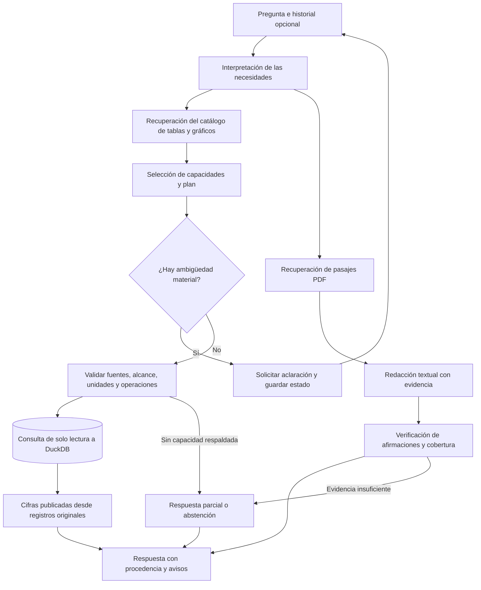

# RAG sobre pensiones y sostenibilidad fiscal — AIReF

**🚧 Work in progress · Prototipo local en desarrollo**

Sistema de preguntas y respuestas que combina documentos de AIReF con datos estructurados de sus tablas y gráficos. El objetivo es responder con cifras trazables y citas verificables, conservando la publicación, el periodo, la unidad y la procedencia de cada dato.

El prototipo usa **LangGraph**, **DuckDB** y modelos locales servidos por **Ollama**. La entrada pública de esta instantánea es `experiments.query_graph`: Qwen3.5 9B para interpretar, planificar y verificar texto; Qwen3-Embedding 4B para recuperación semántica. No requiere claves de API.

## Flujo actual



Las cifras no se dejan a la memoria del modelo: se recuperan mediante operaciones permitidas sobre registros identificados. Las explicaciones se contrastan con pasajes documentales. El sistema puede pedir una aclaración, publicar sólo la parte respaldada o abstenerse. Estas comprobaciones reducen riesgos, pero no garantizan que cualquier respuesta nueva sea correcta.

## Ejecutar el prototipo

Requiere Python 3.11, Ollama y recursos suficientes para los modelos 9B y 4B. La latencia y la memoria dependen del equipo; no se ofrece un mínimo de hardware validado. Los modelos ocupan varios GB y se descargan por separado.

Desde esta carpeta, en PowerShell:

```powershell
python -m venv .venv
.\.venv\Scripts\python.exe -m pip install -r requirements-langgraph.lock.txt
.\.venv\Scripts\python.exe prepare_runtime.py
ollama pull qwen3.5:9b
ollama pull qwen3-embedding:4b
```

Con Ollama en ejecución en su dirección local predeterminada:

```powershell
.\.venv\Scripts\python.exe -m experiments.query_graph --query "Según el informe de 2026, ¿qué gasto en pensiones se prevé para 2050?" --output outputs/consulta.json
```

El ejemplo muestra cómo consultar; no constituye una respuesta de referencia validada. Los modelos se comprueban por digest: si una etiqueta de Ollama pasa a apuntar a otros pesos, el prototipo puede rechazarla. Las identidades esperadas están en `rag_pensiones/graph_types.py`.

Para continuar una aclaración, usar el identificador de conversación con `--thread-id` y la respuesta con `--resume`; `--query` sigue siendo obligatorio. `--json` muestra la traza completa. Las salidas nuevas no sobrescriben una consulta ya guardada.

## Organización

| Ruta | Contenido |
| --- | --- |
| `rag_pensiones/` | Grafo, recuperación, contratos, validación y clientes locales |
| `experiments/` | Entrada CLI y dependencias de consulta y procedencia del prototipo |
| `runtime/` | Instantánea comprimida de los recursos necesarios y manifiesto SHA-256 |
| `prepare_runtime.py` | Restaura y verifica los recursos sin ejecutar modelos |
| `requirements*.txt` | Dependencias del entorno |

Se conserva el nombre `experiments` porque el flujo actual importa estos módulos. Algunos contienen también utilidades de construcción históricas: esta entrega soporta la **consulta de la instantánea incluida**; no empaqueta todo el proceso previo de curación ni sus archivos de trabajo. No es necesario reconstruir embeddings para ejecutar la consulta.

Los recursos se distribuyen comprimidos para respetar los límites por archivo de GitHub. Al prepararlos se restauran sus bytes originales y sus rutas de ejecución, incluidas algunas bajo `evaluation/`: esos archivos son la base y los certificados que el código utiliza, no resultados temporales de pruebas. La instantánea contiene 1.314 fichas, 42.880 observaciones y 440 fragmentos documentales. Los modelos, las cachés de construcción, los entornos virtuales, los checkpoints y los historiales de experimentación quedan fuera.

## Estado y límites

El perfil incluido es `langgraph-9b-v6`. **Todavía no ha superado la validación completa necesaria para su adopción.** Hay fallos conocidos de selección e interpretación en evaluaciones de candidatos anteriores; no se atribuyen sus métricas a esta versión. No se presenta una puntuación global de calidad para esta entrega.

El alcance está limitado a las fuentes incluidas de 2025 y 2026. Las diferencias entre publicaciones o entre Excel y PDF no se reconcilian inventando cifras: se mantienen las políticas y avisos curados. El sistema no calcula pensiones individuales ni debe utilizarse como asesoramiento financiero o como servicio de producción. La comprobación del paquete y de su carga local no equivale a una evaluación de respuestas con los modelos.

## Fuentes y atribución

Los documentos y libros de datos proceden de **AIReF — Autoridad Independiente de Responsabilidad Fiscal**. Se conservan como evidencia de las consultas, con identificación y hashes en los recursos del prototipo. Los informes incluidos son la Opinión sobre sostenibilidad a largo plazo de 2025 y el Estudio de evaluación de la regla de gasto en pensiones de 2026. También se incluye la estrategia de financiación de 2022 del **Tesoro Público**, utilizada como fuente puntual de contraste; no se atribuye a AIReF. Los datos derivados y las anotaciones del proyecto no son publicaciones oficiales de AIReF. Este proyecto es independiente y no implica su respaldo.

La documentación de origen permite su reproducción citando a AIReF; los derechos de los documentos y materiales de terceros siguen perteneciendo a sus titulares. No se concede aquí una licencia adicional sobre esos materiales.
